# Fishbowl

[](https://github.com/CoreXI7/fishbowl/actions/workflows/ci.yml)

Your whole home server on one page: services, Plex, downloads, drives and security at a glance.

| Light | Dark |
|---|---|
| 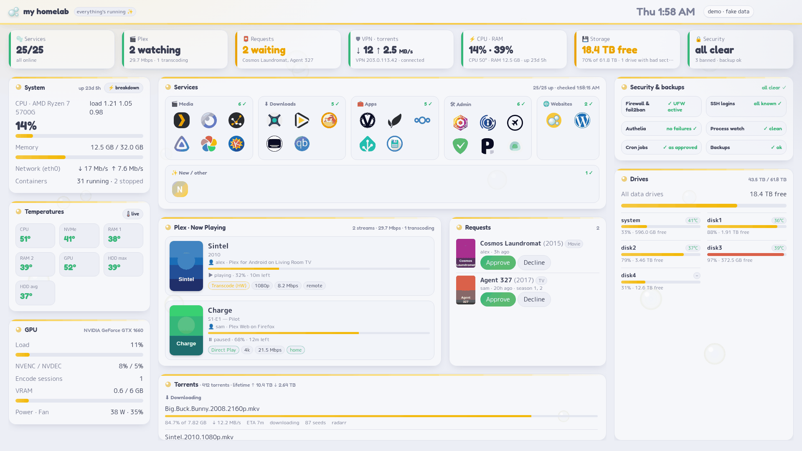 | 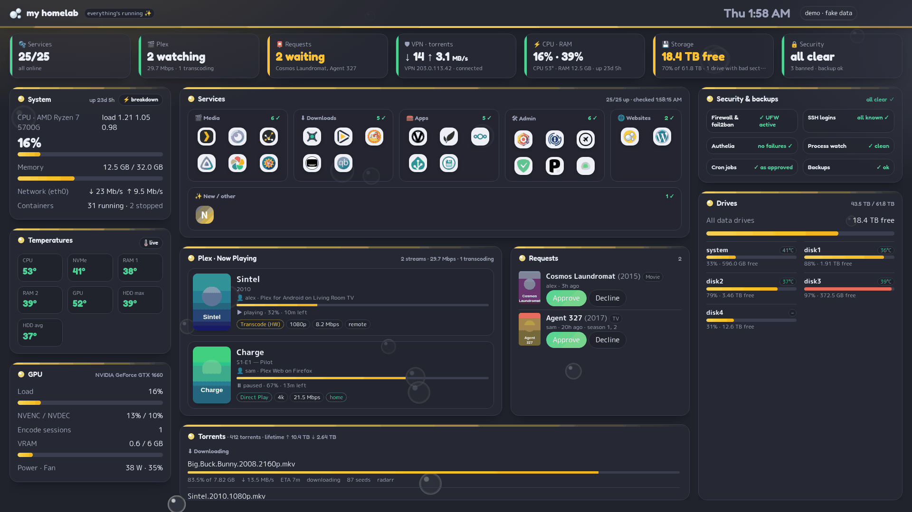 |

Plain Python, no extra packages, one Docker image (`ghcr.io/corexi7/fishbowl`, amd64 and arm64).

**Try it first:** there's a [live demo](https://demo.vicy.us) with made-up data.

## Features

- **Services:** up or down, found on their own from Nginx Proxy Manager, plain Nginx configs or a Caddyfile, or added by hand
- **Plex:** who is watching what (via Tautulli)
- **Requests:** new Seerr requests, with Approve and Decline
- **Downloads:** qBittorrent or Transmission progress and speeds, SABnzbd's Usenet queue, and a warning if qBittorrent shows
  your real IP instead of your VPN's
- **System:** CPU, memory, network, temperatures and NVIDIA GPU, with a live view that updates every second
- **Drives:** space, SMART health and temperatures, and ZFS pools (state, per-disk errors, scrub)
- **Security:** blocked logins, SSH logins from new places, changed cron jobs, last backup
- **Wall mode** for an always-on screen, four themes with light and dark modes, built-in sign-in with two-step codes

Drives, GPU and security need the optional [collector](#the-collector).

## Security

A dashboard sees a lot about your server, so security came first, not last. The design goal: even someone who fully
breaks into the dashboard gets as little as possible.

### How it's built

- **Root and the network never meet.** The dashboard is reachable from the network but has no special permissions.
  The collector runs as root but never touches the network, in the strictest systemd sandbox it still works under.
  It only writes files; the dashboard only reads them.
- **The container is locked down:** normal user, read-only file system, no capabilities, 256 MB memory cap.
- **Root never acts on a web request by itself.** A settings change that would make root read a new file waits until
  you approve it on the server (`sudo homelab-dash-collector --apply`), which shows exactly what changes.

### Signing in

- **Nothing is visible without signing in**, either with Fishbowl's own sign-in or your existing login page
  (Authelia, Authentik, …) with `AUTH: proxy`.
- **Strong passwords:** at least 15 characters, checked against a list of common ones.
- **Two-step codes** from an authenticator app, with one-time recovery codes.
- **Guessing gets slow:** every wrong try makes the next one wait longer, and if someone gets your password right but
  not your code, you're warned the next time you sign in.

### Talking to the network and other apps

- **Only your reverse proxy can connect**, and changes are only accepted from the dashboard's own page.
- **API keys never reach the browser.** Changing an app's address means entering its key again, so a saved key can't
  be redirected.
- **Everything from other apps is untrusted:** qBittorrent, Transmission, SABnzbd, Seerr, Tautulli and `zpool` output is checked, size- and
  time-limited, and escaped, so a compromised app can't take over the page or crash the dashboard.

### How it was tested

Most of the code was written with AI (Claude Code) and designed, directed and tested by a person. Because AI-written
code deserves extra suspicion, before 1.0 it went through four rounds of focused AI security review (sign-in, web
requests, browser attacks, the collector) against test copies behind real reverse proxies, plus HTTP fuzzing. Every
finding was fixed with a test that failed before the fix; [the full list](SECURITY-TESTING.md#every-finding-of-the-10-audit)
is public. 430+ tests run in CI.

This is not a professional audit, and AI reviewers can share blind spots with the AI that wrote the code: see
[THREAT-MODEL.md](THREAT-MODEL.md) for the known limits. Found a problem? Report it privately ([SECURITY.md](SECURITY.md)).

## Install

You need Linux with Docker Compose and a reverse proxy that gives the dashboard an HTTPS address.

```sh
git clone https://github.com/CoreXI7/fishbowl && cd fishbowl
mkdir data && sudo chown 1000:1000 data      # or your own user: see PUID/PGID in docs/INSTALL.md
```

Set `ORIGIN`, `TRUSTED_PROXY` and the proxy network in `docker-compose.yml`, then:

```sh
docker compose up -d
docker logs dash 2>&1 | grep "^SETUP CODE" | tail -n 1
```

Point your reverse proxy at `dash:8000`, open the address, enter the setup code and create your account. API keys
(qBittorrent, Seerr, Tautulli...) go on the settings page; they're stored in `data/secrets.json` (mode 600), so there's
no separate secrets file to manage. The
**Setup** page under ⚙ checks the rest of your install. Step by step, with every option: [docs/INSTALL.md](docs/INSTALL.md).

### The collector

Some data can only be read as root (SMART, firewall, SSH log, cron, backup logs). Instead of giving the dashboard
those powers, a small root service on the host reads them and writes files the dashboard mounts read-only.

```sh
sudo bash collector/install.sh              # dashboard running as another user? add --uid <PUID>
```

## Wall mode


Made for a TV or spare monitor: everything fits one 1920×1080 screen, calm while all is well, loud when something
needs you. Press `W`, click 🖥, or add `?wall` to the address. `T` switches theme, `M` turns the background animation
on or off.

## Themes and dark mode

Four themes, each with its own colours, tab icon and greeting. Bubbles, Miku and Gura have a light and a dark version
and follow your device's light/dark setting on their own; Neon is always dark. Pick a theme in ⚙ (it becomes the
default for every browser) or cycle with `T` (remembered by that browser only).
Each theme can also have your own mascot picture, tab icon and lines: upload them in ⚙ under Themes.

| Theme | Light | Dark |
|---|---|---|
| **Bubbles** (default) |  |  |
| **Miku** | 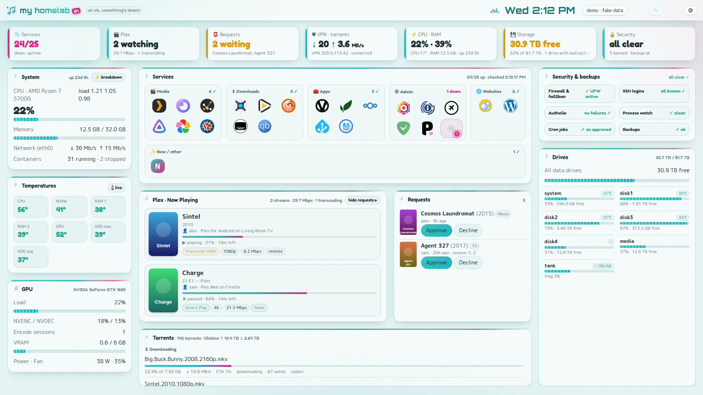 | 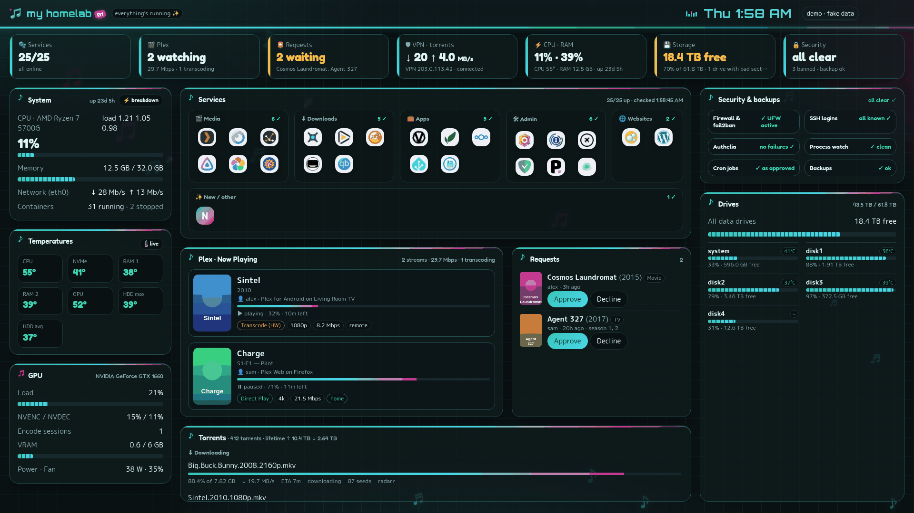 |
| **Gura** | 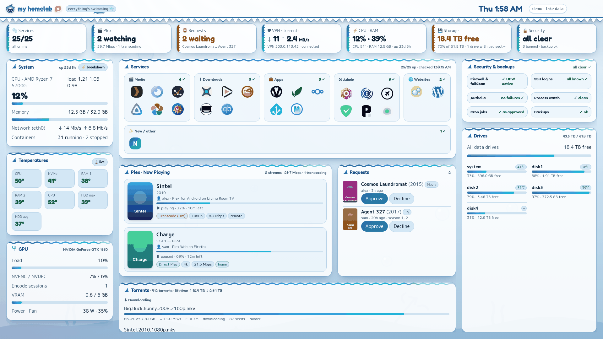 | 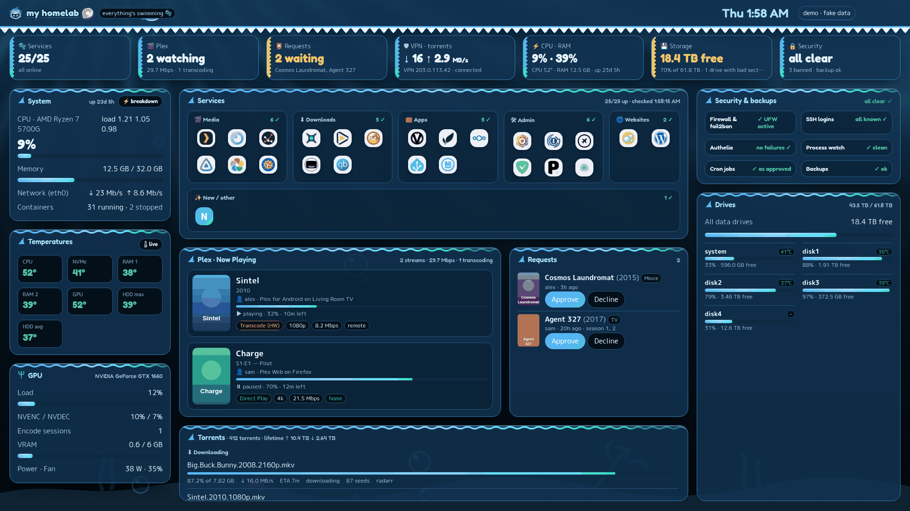 |
| **Neon** | (always dark) | 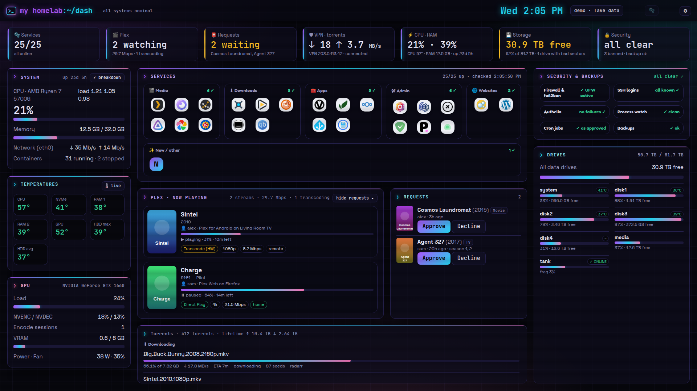 |

## Screenshots

All screenshots use the demo's made-up data.

| | |
|---|---|
| 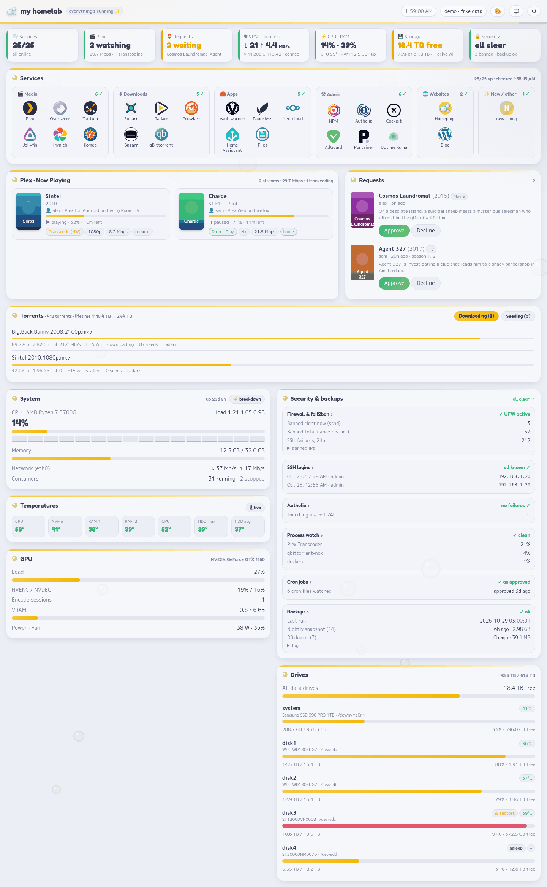 Full page | 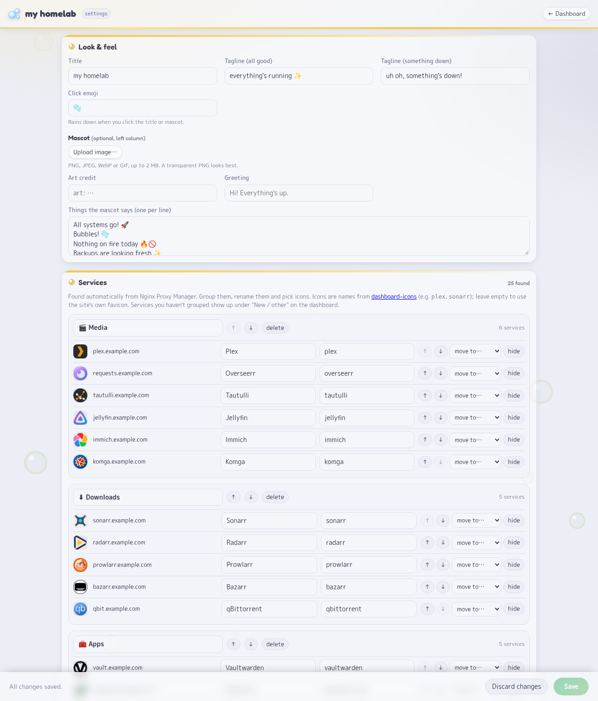 Settings |
| 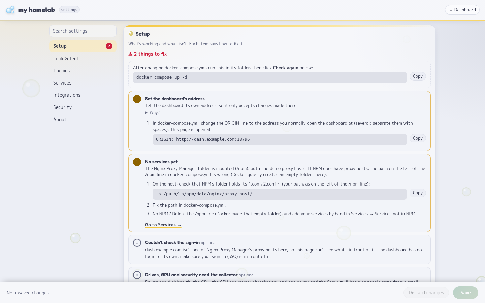 Setup checklist | 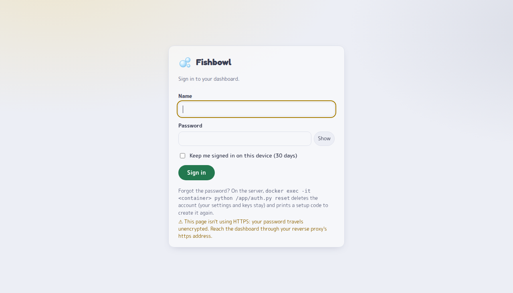 Sign-in |
| 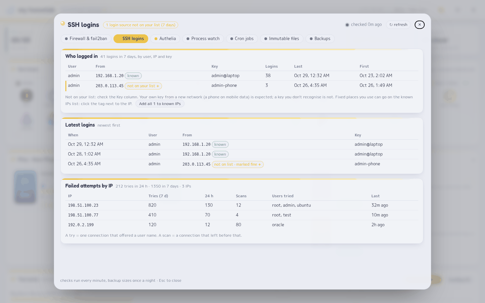 Security: SSH logins | 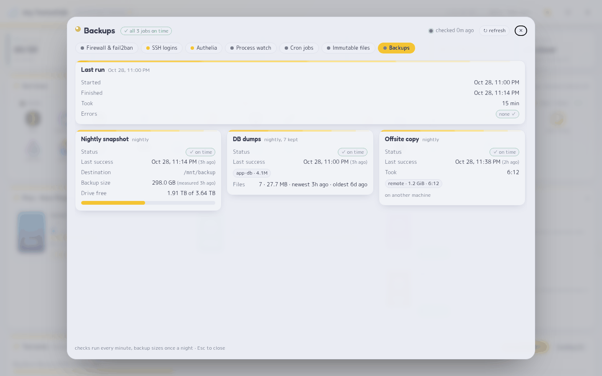 Security: backups |
| 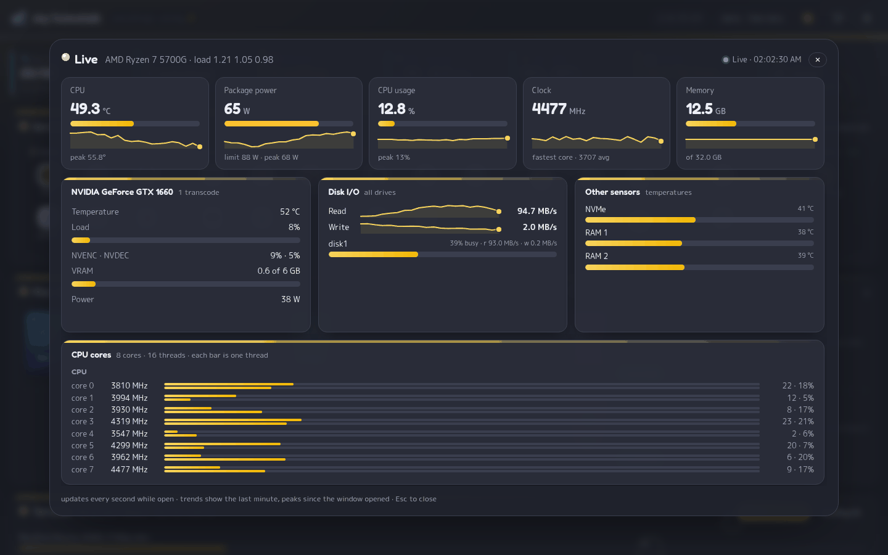 Live view | 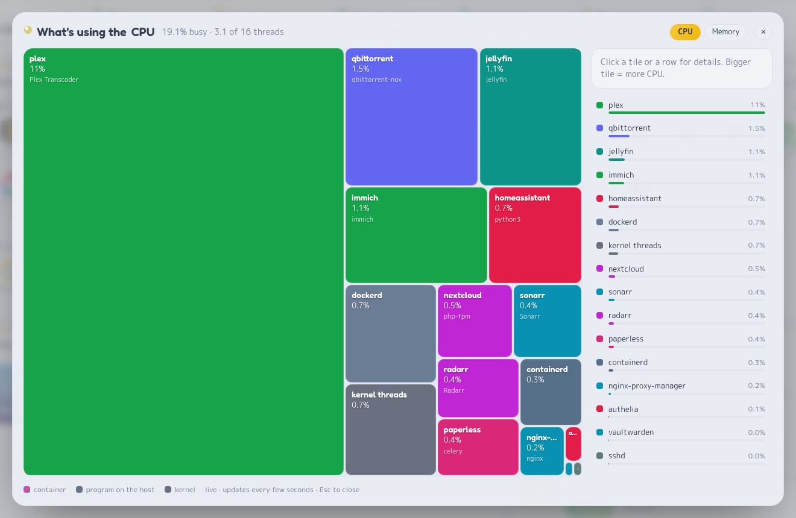 What's using the CPU |
| 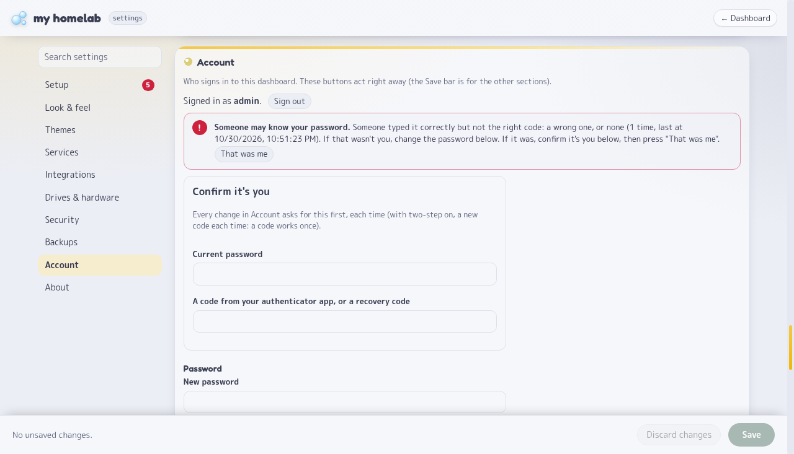 Account settings | |

## Updating

```sh
git pull && docker compose pull && docker compose up -d
sudo bash collector/install.sh    # if you use the collector
```

## More

- [docs/INSTALL.md](docs/INSTALL.md): full install, the collector, reverse proxy headers
- [docs/SETTINGS.md](docs/SETTINGS.md): every setting
- [Architecture](ARCHITECTURE.md) · [Testing](TESTING.md)

## Contributing

Issues and pull requests are welcome. Run `python3 -m unittest discover -s tests` before sending a change.

## License

MIT
