# Fishbowl

Your whole home server in one glanceable page.

| Light | Dark |
|---|---|
| 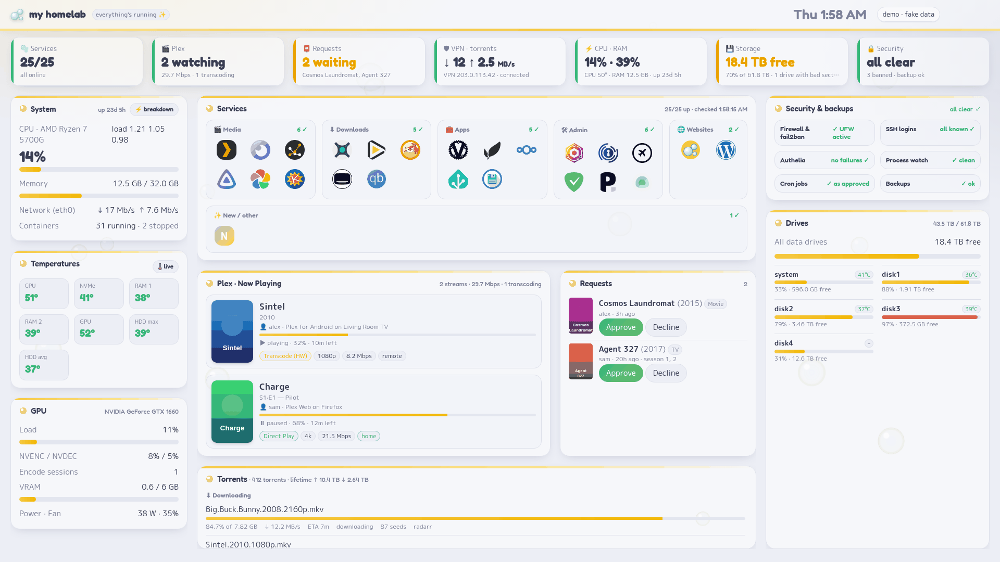 | 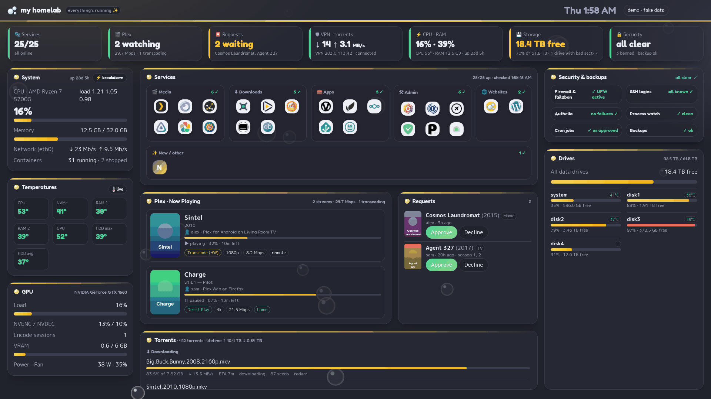 |

Fishbowl is a dashboard for a home server. Open it in a browser (or leave it on a spare screen) and you can see at a
glance whether everything is running: your services, who is watching Plex, new media requests, downloads, temperatures,
drives, and recent security events.

It's written in plain Python with no extra packages, and runs in Docker.

**Try it first:** there's a [live demo](https://demo.vicy.us) with made-up data.

## Contents

- [What it shows](#what-it-shows)
- [What you need](#what-you-need)
- [Install](#install)
- [Using it](#using-it)
- [Updating](#updating)
- [Screenshots](#screenshots)
- [Security](#security) and [how it was tested](#how-it-was-tested)
- [Contributing](#contributing)
- [License](#license)

## What it shows

- **Services:** whether each of your web services is up. If you use Nginx Proxy Manager, Fishbowl finds them on its
  own; otherwise you add them on the settings page.
- **Plex:** who is watching what right now (needs Tautulli).
- **Requests:** new movie and TV requests from Seerr, with Approve and Decline buttons.
- **Downloads:** qBittorrent's progress and speeds, plus a warning if your real IP address is showing instead of your
  VPN's.
- **System:** CPU, memory, network and temperatures, with a live view that updates every second.
- **GPU:** usage and video encoding for NVIDIA cards. Other GPUs aren't supported yet.
- **Drives, security and backups:** disk space and health, blocked login attempts, SSH logins from new places, changed
  scheduled jobs, and whether your last backup ran. These need the optional [collector](#optional-install-the-collector).

It also has a wall mode for an always-on screen, three themes in light and dark, and its own sign-in.

## What you need

- A Linux server with Docker and Docker Compose
- A reverse proxy that gives the dashboard an HTTPS address (any one you already use is fine)
- Optional, for the collector: Python 3.11 or newer, systemd and `smartctl` on the server

## Install

### 1. Download Fishbowl

```sh
git clone https://github.com/CoreXI7/fishbowl
cd fishbowl
```

### 2. Create the data folder and the `.env` file

Fishbowl saves its settings in `data/`. The `.env` file can hold your API keys, but it can stay empty, since you can
also enter keys on the settings page later.

```sh
mkdir data
sudo chown 1000:1000 data
cp .env.example .env
chmod 600 .env
```

### 3. Edit `docker-compose.yml`

Open `docker-compose.yml` and change these lines to match your server:

- `ORIGIN`: the address you'll open the dashboard at, for example `https://dash.example.com`
- `TRUSTED_PROXY`: the container name of your reverse proxy (it's set to `nginx` by default)
- `networks`: the Docker network your reverse proxy is on (`reverse_proxy` by default)
- The `proxy_host` volume: the path to Nginx Proxy Manager's `data/nginx/proxy_host` folder. Delete this line if you
  don't use Nginx Proxy Manager.

### 4. Start it

```sh
docker compose up -d
```

### 5. Connect your reverse proxy

In your reverse proxy, send your chosen address (for example `dash.example.com`) to `dash`, port `8000`.

Your proxy also needs to pass on each visitor's real IP address, so Fishbowl can tell visitors apart. The exact lines
for each proxy are in [docs/SETTINGS.md](docs/SETTINGS.md#signing-in-auth-login-the-default). The settings page will
remind you if this is missing.

### 6. Create your account

Open your dashboard's address. The first time, it asks for a one-time setup code. Get it from the container's log:

```sh
docker logs dash 2>&1 | grep "^SETUP CODE" | tail -n 1
```

Then choose a name and a password of at least 15 characters (a few random words work well).

Already have a login page in front of your services, like Authelia or Authentik? Then you can turn Fishbowl's own
sign-in off: add `AUTH: proxy` under `environment:` in `docker-compose.yml` and run `docker compose up -d` again.

### 7. Finish setup in the browser

Click the **⚙** button and open **Setup**. It checks your install and tells you how to fix anything that's missing.
Then connect your apps under **Integrations**: qBittorrent, Seerr and Tautulli each have a **Test** button.

### Optional: install the collector

The collector is a small helper that runs directly on your server, outside Docker. It reads things the dashboard
can't see from inside its container: drives, the GPU, power use, and security logs.

```sh
sudo bash collector/install.sh
sudo nano /etc/homelab-dash/collector.toml
sudo systemctl restart homelab-dash-collector
```

In `collector.toml`, list your drives and, if you use them, your fail2ban jail and backup log. To remove the
collector: `sudo bash collector/install.sh --uninstall`.

#### How the collector works

Some of what Fishbowl shows can only be read as root: SMART data from your drives, the firewall and fail2ban, the
SSH login log, scheduled jobs, and backup logs. Instead of giving the dashboard those powers, a separate program
does that part:

1. **It runs on the host as a systemd service,** as root, once every few seconds.
2. **It writes what it found to files** in `/var/lib/homelab-dash/`.
3. **The dashboard only reads those files.** They're mounted into its container read-only.

The collector never connects to the network. The installer tests it under three systemd sandboxes and keeps the
strictest one it still works under: no network at all, a read-only system apart from its own folder, and only the
root permissions it needs.

You can change most of its settings on the dashboard's settings page. Simple switches, like which drives to show,
apply by themselves. Anything that would make root read a file or run a search pattern, like a new log file to
watch, waits until you approve it on the server:

```sh
sudo homelab-dash-collector --apply
```

It shows exactly what will change and asks first.

## Using it

- **Settings:** click ⚙ (or go to `/settings`). Everything from your services to themes to your account is set there,
  and changes apply right away.
- **Two-step sign-in:** go to ⚙ → **Account** to add an authenticator app. Keep the recovery codes it gives you.
- **Wall mode:** press `W` for a full-screen view made for a TV or spare monitor. `T` changes the theme.
- **Locked out or forgot your password:** run `docker exec -it dash python /app/auth.py reset` on the server. It
  removes the account (your settings stay) and prints a new setup code.

Every setting is explained in [docs/SETTINGS.md](docs/SETTINGS.md).

## Updating

```sh
cd fishbowl
git pull
docker compose up -d --force-recreate
```

If you use the collector, update it too: `sudo bash collector/install.sh`.

Tip: if you changed `docker-compose.yml`, `git pull` may refuse to update it. Putting your changes in a file called
`docker-compose.override.yml` instead avoids that.

## Screenshots

All screenshots use the demo's made-up data.

| | |
|---|---|
| 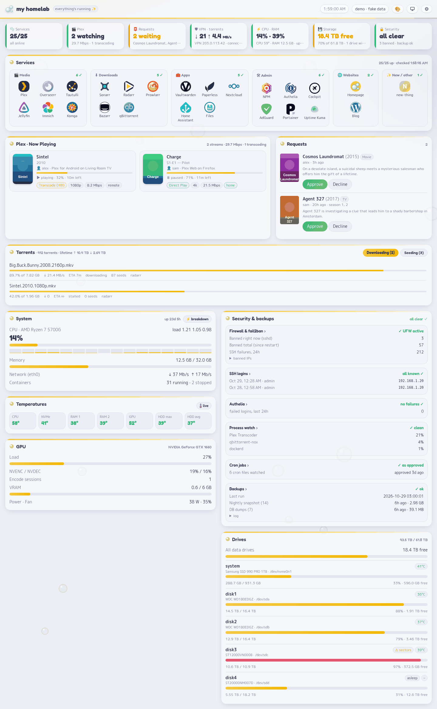 Full page | 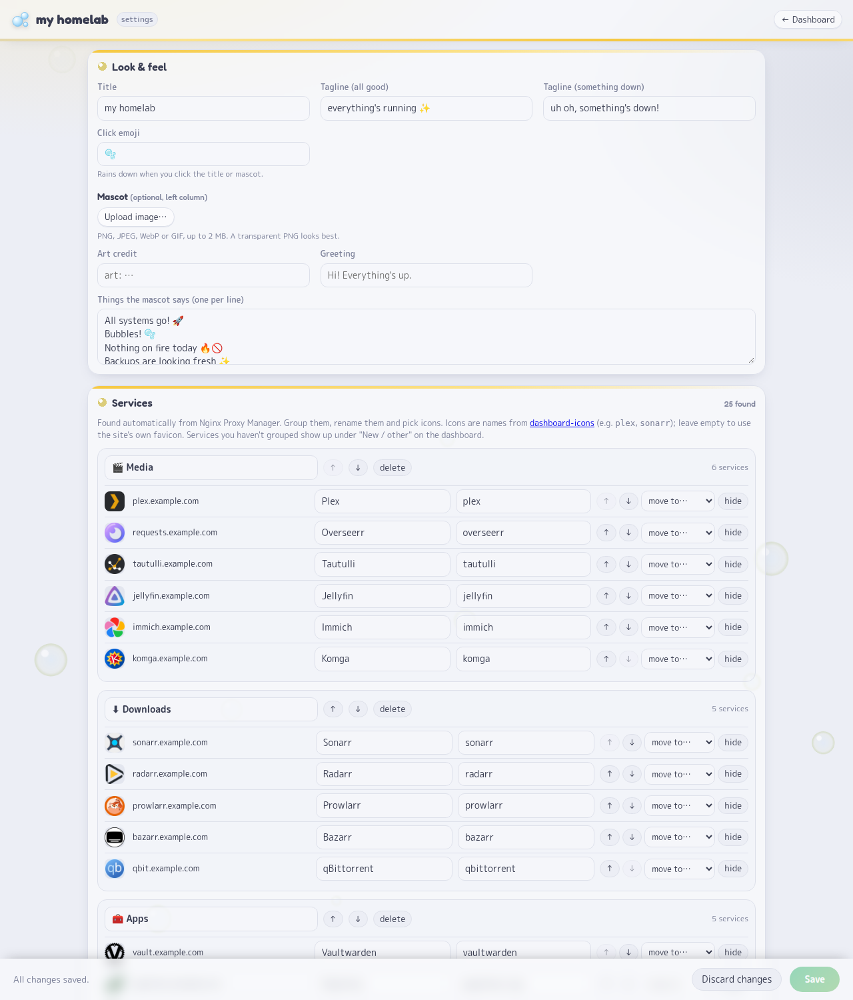 Settings |
| 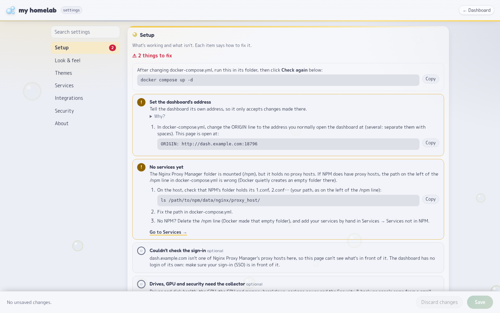 Setup checklist | 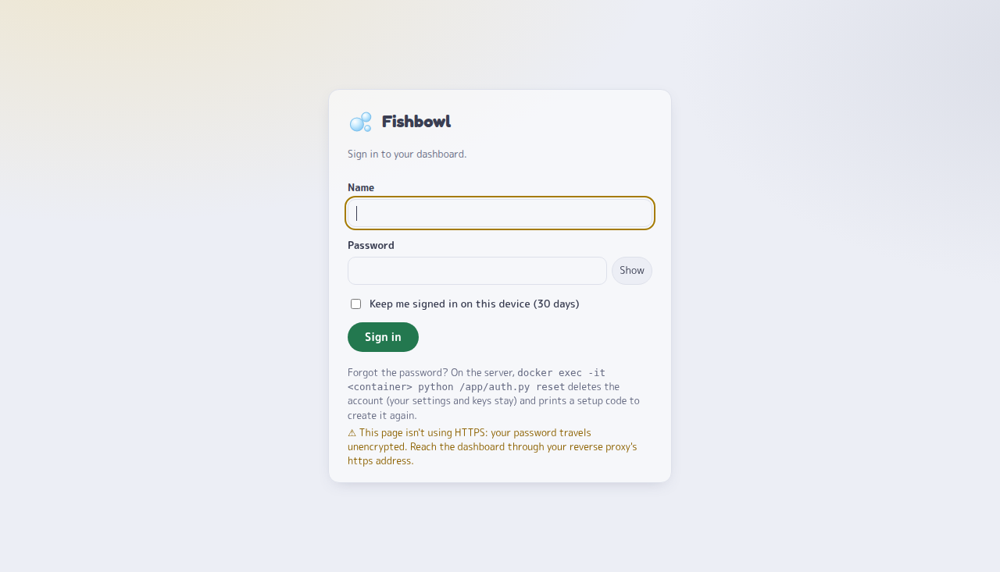 Sign-in |
| 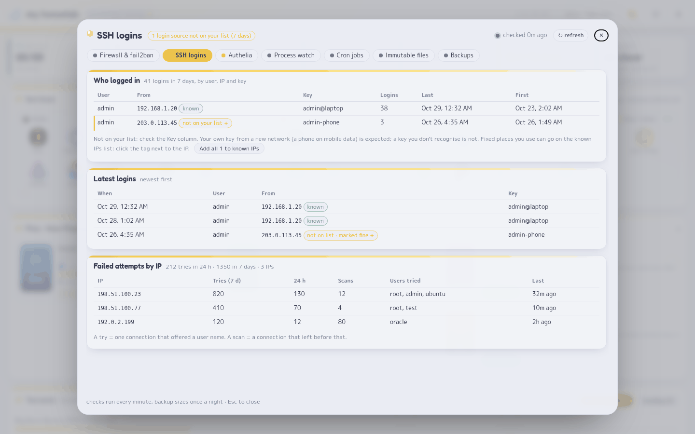 Security: SSH logins | 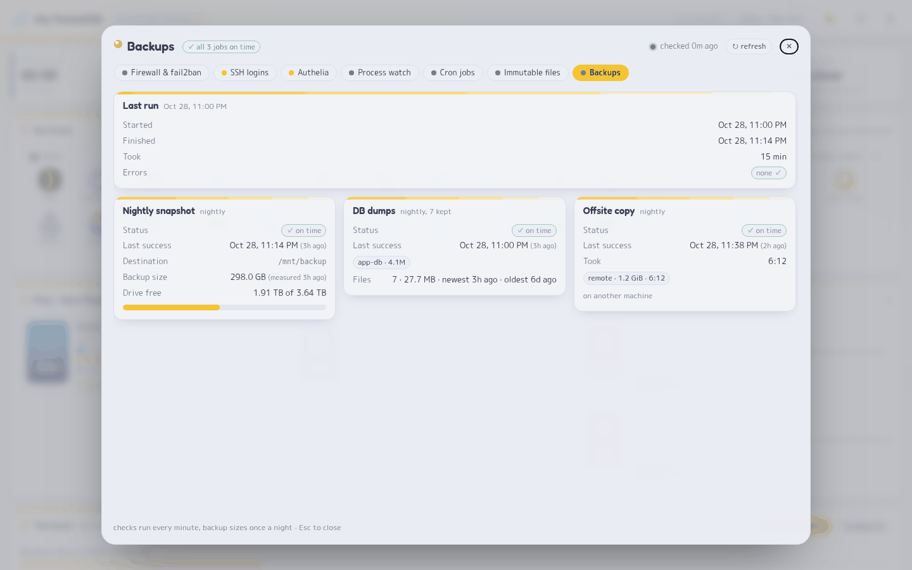 Security: backups |
| 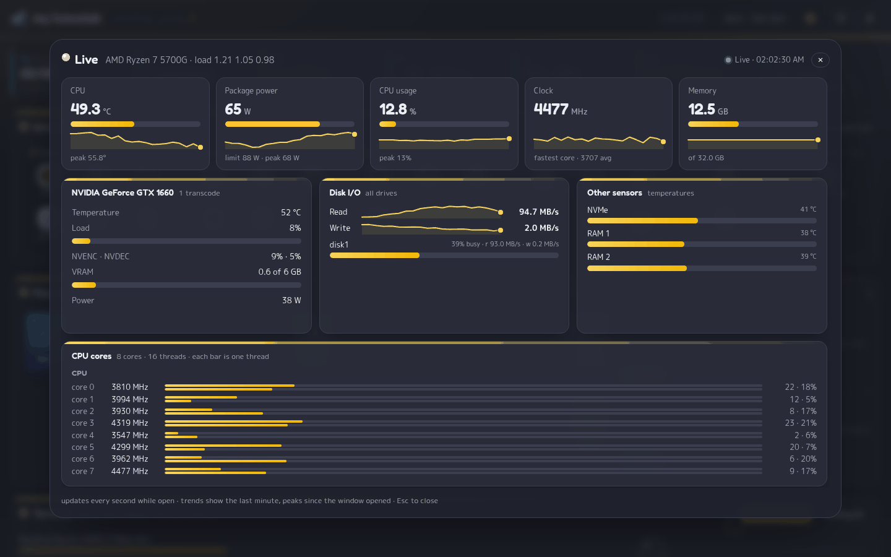 Live view | 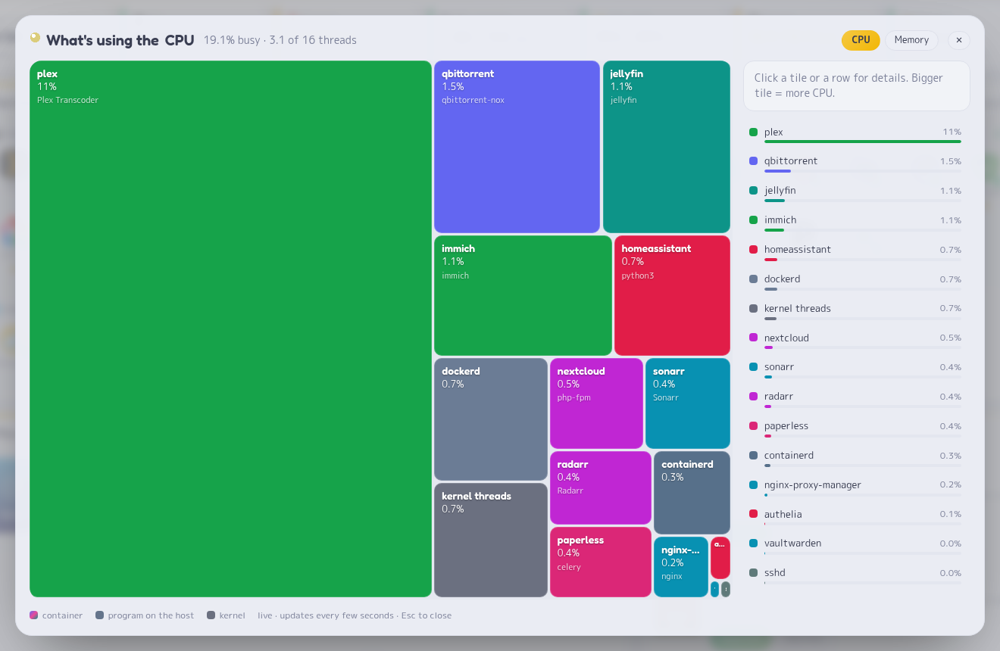 What's using the CPU |
| 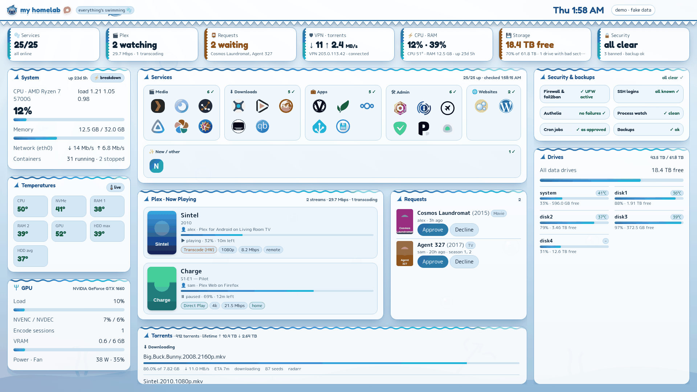 Gura theme | 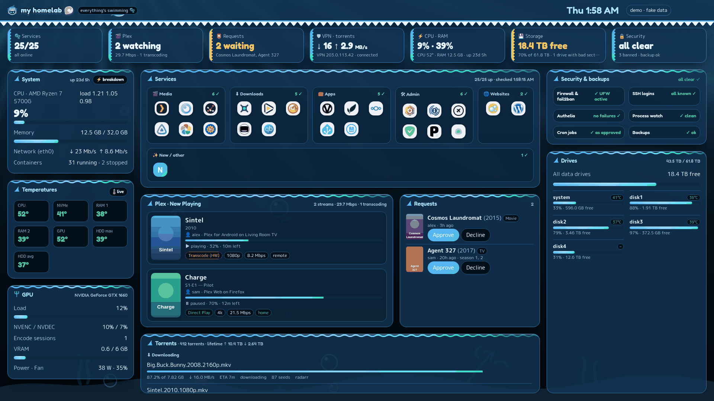 Gura theme, dark |
| 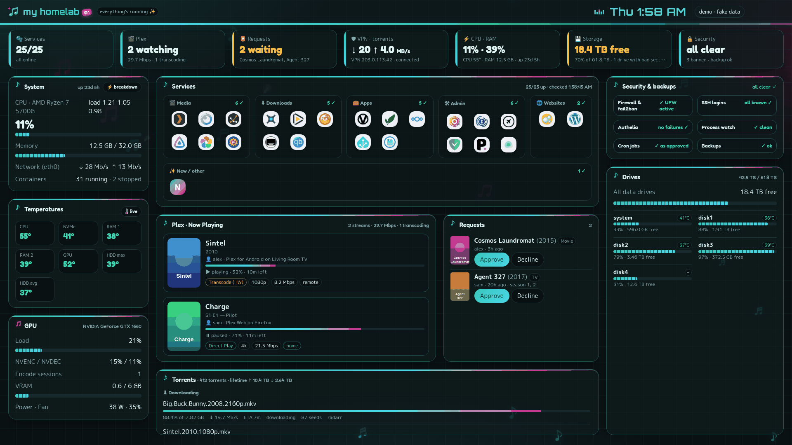 Miku theme | 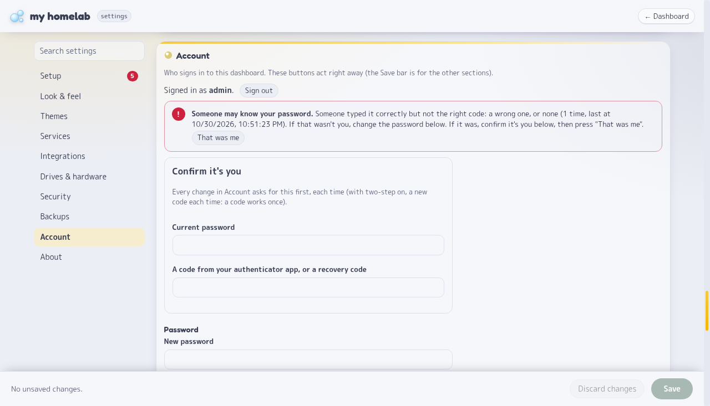 Account settings |

## Security

A dashboard like this sees a lot about your server, so it was built to be hard to misuse.

**Signing in**

- Nobody can see or change anything without signing in, either with Fishbowl's own sign-in or your existing login
  page (`AUTH: proxy`).
- Passwords must be at least 15 characters and are checked against a list of common passwords. Length is what
  protects a password if a copy of its stored form ever leaks.
- Two-step sign-in with an authenticator app is built in, with one-time recovery codes.
- Repeated wrong guesses make everyone wait longer between tries. If someone types your correct password but not
  your two-step code, you're warned the next time you sign in.

**The dashboard**

- Only your reverse proxy can connect to it (`TRUSTED_PROXY`), and changes are only accepted from the dashboard's own
  page, so other websites can't act on your behalf.
- Your API keys stay on the server and are never sent to the browser. Changing an app's address means entering its
  key again, so nobody can send your saved key somewhere else.
- Everything that comes from qBittorrent, Seerr or Tautulli is treated as untrusted: checked, size-limited and
  time-limited, so a compromised app can't take over the page or crash the dashboard.
- Connections that carry an API key or password (qBittorrent, Seerr, Tautulli) check HTTPS certificates normally.
  The up/down checks and icon downloads accept self-signed certificates, since most home services use them; they
  send no keys or passwords, don't follow redirects to other hosts, and only keep plain images. Details:
  [THREAT-MODEL.md](THREAT-MODEL.md#outbound-requests-certificates-redirects-and-whats-sent).
- The container runs as a normal user, with a read-only file system and no extra permissions, and is limited to
  256 MB of memory.

**Kept apart:** the dashboard, which is reachable from the network, has no special permissions. The collector, which
runs as root, can't be reached from the network at all. So someone who breaks into the dashboard still can't control
your server.

### How it was tested

Before version 1.0, Fishbowl went through a security review in four rounds. Each round, a fresh set of reviewers (AI
agents, each focused on one area: sign-in, web requests, browser attacks, the collector, encryption, fuzzing, and
more) tried to break it, and every problem they found was fixed before the next round.

- **40 reviews** in total, run against test copies only, with real reverse proxies (Nginx Proxy Manager, Caddy,
  HAProxy, Traefik) and real browsers (Chrome, Firefox).
- **Over 15 million automated attack attempts** (fuzzing).
- **2 high and about 50 medium issues found, all fixed.** Each fix has an automated test, so the problem can't quietly
  come back. The last three rounds found no way to get in.

This was an AI-assisted review, not an audit by an outside security company. The full results are in
[TESTING.md](TESTING.md), and [THREAT-MODEL.md](THREAT-MODEL.md) lists the known limits.

The reviewers' attack scripts aren't in this repository: they were written for throwaway test copies and most no
longer run against the current code. Instead, every problem they found has an automated test in `tests/` that failed
before the fix and passes now, so you can check the fixes yourself with `python3 -m unittest discover -s tests`.
[SECURITY-TESTING.md](SECURITY-TESTING.md#every-finding-of-the-10-audit) lists every finding with the commit that
fixed it and the test that checks it.

Found a security problem? Please report it privately, as described in [SECURITY.md](SECURITY.md).

## Contributing

Bug reports and pull requests are welcome. Before sending a change, run the tests:

```sh
python3 -m unittest discover -s tests
```

[ARCHITECTURE.md](ARCHITECTURE.md) explains how the code is laid out.

## License

MIT
