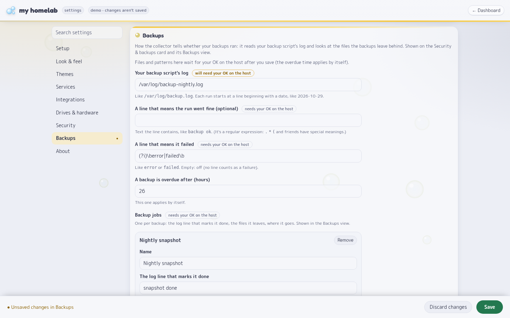

# Fishbowl 🐟🫧

*Your whole server in a fishbowl.*

**One page that tells you if your home server is OK.** Services up or down, who's watching Plex, pending requests,
torrents (with a VPN-leak alarm), temperatures, drives, security and backups, all at a glance.

- Small: one stdlib-Python app. No pip, no Node, no database. About 25–40 MB of RAM.
- Easy: set it up from a settings page in your browser. Its **Setup checklist** tells you what's missing and how to
  fix it. Services from Nginx Proxy Manager show up on their own.
- Safe: your API keys stay on the server, and the part that runs as root never talks to the network (the installer also
  locks it into the strictest sandbox it works under).

> **🔑 It has its own sign-in, on by default:** one account, an optional authenticator app (two-step sign-in) and
> recovery codes. Already have SSO in front of it (Authelia, Authentik, an access list)? `AUTH: proxy` turns Fishbowl's
> own off, so you sign in once. How it's built to be safe, and how to report a problem: [SECURITY.md](SECURITY.md).
> Everything it was tested against, and the results: [SECURITY-TESTING.md](SECURITY-TESTING.md).

**▶ [Try the live demo](https://demo.vicy.us)** (fake data, nothing you do there is saved)


| Light | Full page |
|---|---|
|  |  |

*Screenshots use demo mode: fake data, Blender open-movie titles.*

---

## Contents

- [What you get](#what-you-get)
- [Quick start](#quick-start) · [**Signing in**](#signing-in)
- [Tips: keys, clicks and links](#tips-keys-clicks-and-links)
- [What's new](#whats-new-october-2026), including [**what to check when you update**](#updating-what-to-check)
- [Settings](#settings)
- [Security in short](#security-in-short)
- [Host a public demo](#host-a-public-demo) · [Tests](#tests) · [More docs](#more-docs)

---

## What you get

| Panel | What it shows |
|---|---|
| **Services** | Every proxy host in Nginx Proxy Manager, with an icon, checked every 30 s. Healthy tiles stay quiet; a down one gets a red **!** badge. Not using NPM? Add them on the settings page. |
| **Plex Now Playing** | Who's watching what, direct play or transcode, home or remote (via Tautulli). |
| **Requests** | Seerr / Overseerr / Jellyseerr requests, with **Approve** and **Decline** buttons. |
| **Torrents** | qBittorrent downloads and speeds, plus a **big red banner if your real home IP shows** (VPN leak). |
| **System** | CPU per thread, RAM, network, temperatures, NVIDIA GPU incl. NVENC/NVDEC. |
| **⚡ Breakdown** | A live, animated map of what's using your CPU or memory, one tile per container or program. |
| **🌡 Live window** | Temps, power, clocks, memory and disk I/O every second, with one-minute trends. |
| **Drives** | Space used plus SMART health and temperature, without waking sleeping disks. |
| **Security & backups** | fail2ban, SSH logins from unknown places, Authelia failures, a crypto-miner watch, cron changes, locked files, and whether last night's backup ran. Click any box for the full details. |

Plus three themes (Bubbles, Miku, Gura), automatic light/dark, and a **wall mode** made for a screen that's always on.
Every panel is optional: unconfigured ones hide themselves, and you can hide any panel on the settings page.

> Drives, GPU, power and the Security & backups panel need the optional **root collector** (step 2 below).

---

## Quick start

### Just look (demo mode, no setup)

```sh
git clone https://github.com/CoreXI7/fishbowl && cd fishbowl
DEMO=1 python3 app/app.py          # Python 3.11+, then open http://localhost:8000
```

### Install for real

**1. The dashboard** (Docker)

```sh
mkdir data && sudo chown 1000:1000 data     # your settings, saved keys and uploads live here
cp .env.example .env && chmod 600 .env      # needed, but can stay empty: keys can be typed on the settings page
```

Open `docker-compose.yml` and set four things: `ORIGIN` (your dashboard's URL), `TRUSTED_PROXY` (your reverse proxy's
container name), the path to your NPM `proxy_host` folder, and your proxy's Docker network. Then:

```sh
docker compose up -d
```

In NPM, add a proxy host that forwards to `dash:8000` (with HTTPS), and in it add `set_real_ip_from 127.0.0.2/32;`
under **Advanced** and turn on **Force SSL** (otherwise a visitor can choose the address the dashboard sees; other
proxies: [docs/SETTINGS.md](docs/SETTINGS.md#signing-in-auth-login-the-default)). Open the dashboard: the first time, it asks you to
create your account, with a one-time **setup code** from the container's log
(`docker logs dash 2>&1 | grep "^SETUP CODE" | tail -n 1`).
Already have SSO (Authelia, Authentik, …)? Put the proxy host behind it and set `AUTH: proxy` instead.
Then click **⚙**: the **Setup** checklist checks the rest and gives the exact fix for anything missing.

> **Forgot the password or locked out?** See [Signing in](#signing-in).

> **Empty page or 502?** Run `docker logs dash`. A `TRUSTED_PROXY` name that doesn't resolve refuses everyone, and the log says so.
> Not sure of your proxy's network name? `docker inspect -f '{{range $k,$v := .NetworkSettings.Networks}}{{$k}} {{end}}' <proxy>`

**2. The collector** (optional, runs on the host as root)

```sh
sudo bash collector/install.sh
sudo nano /etc/homelab-dash/collector.toml   # your drives, fail2ban jail, backup jobs, ...
sudo systemctl restart homelab-dash-collector
```

It needs Python 3.11+ and `smartctl`; it also uses `nvidia-smi`, `fail2ban-client` and `docker` if they're there.
It costs under a second of CPU a minute. Remove it with `sudo bash collector/install.sh --uninstall`.
The collector keeps Fishbowl's old name, homelab-dash, in its service and folders, so existing installs update in place.
Its config is a file on purpose: it runs as root, so no web page should be able to change what it does.

---

## Signing in

Fishbowl has its own sign-in, on by default: one account, for you.

**The first time**, the dashboard asks for a **setup code**, a name and a password. The code is in the container's log:

```sh
docker logs dash 2>&1 | grep "^SETUP CODE" | tail -n 1
```

Only the newest code works (a new one appears at every start until the account exists), so nobody who finds a fresh
install before you can claim it. Anyone who can read the container's log (a log viewer like Dozzle or Portainer, a log
shipper) can read the code too: create the account right after the first start.

- **Password**: 15 characters or more (a few random words work well), checked against common passwords. No other rules;
  password managers and pasting are welcome.
- **Two-step sign-in** (recommended): ⚙ → **Account** → set up an authenticator app. Scan the QR code with any
  authenticator app, type a code, and keep the 10 **recovery codes** it shows somewhere safe: each works once, in place of
  a code from the app (for a lost phone).
- **Keep me signed in**: 30 days (7 without a visit), so a wall screen stays up. Without it: 12 hours (1 hour without a
  visit). The sign-out button sits in the header.
- **⚙ → Account**: confirm it's you (the password, plus a code when two-step is on), then change the password, turn
  two-step on or off, make new recovery codes, see which browsers are signed in and sign any of them out, and see recent
  sign-ins and failed tries. A new password signs every other browser out.
- **If someone guesses**: after 5 wrong tries the waits double (up to 15 minutes), for everyone. After 100 in a row,
  browsers that never signed in are locked out until you unlock it on the host; browsers you've signed in with before
  still get in. So someone who keeps guessing (it needs no password) can make a *new* browser of yours wait, or lock it
  out after about a day: sign in from a browser you've used before, or run `auth.py unlock` on the host. Your next
  sign-in tells you what failed since the last one. The right password with a wrong code stays on the Setup checklist
  until you change the password or press "That was me".
- **Plain HTTP** (no HTTPS): passwords are only accepted from your own network, and that sign-in only works from the
  same address. Your browser also sends the dashboard's cookies to every other web app on that address (any port),
  so over plain HTTP only run apps you trust next to it, or put it behind HTTPS on a host name of its own (over HTTPS
  the cookies still go to other HTTPS ports of the same name).
- **Your reverse proxy** must set `X-Real-IP` and `X-Forwarded-Proto` itself, never pass on what the visitor sent.
  Nginx Proxy Manager, Caddy and HAProxy need a line or two for that (NPM: `set_real_ip_from 127.0.0.2/32;` under
  Advanced, and Force SSL); Traefik is fine as it is: see
  [docs/SETTINGS.md](docs/SETTINGS.md#signing-in-auth-login-the-default). The Setup checklist tells you when a header
  is missing (it can't tell when the proxy lets a visitor choose it).

**Forgot the password, locked out, or lost a device?** On the host:

| `docker exec -it dash python /app/auth.py ...` | What it does |
|---|---|
| `status` | The account, the lock, two-step, recovery codes left, signed-in browsers |
| `unlock` | Ends the lock after 100 wrong tries |
| `signout` | Signs every browser out and forgets trusted browsers; the account stays (a lost phone or laptop) |
| `reset` | Deletes the account and every session (settings and keys stay) and prints a new setup code |
| `setup-code` | A new setup code, while there's no account yet |

**Already have SSO** (Authelia, Authentik, an access list)? Add `AUTH: proxy` to the `environment:` in
docker-compose.yml so you sign in only once. It needs `TRUSTED_PROXY` too: without it anyone could go around your
proxy's sign-in, so Fishbowl keeps its own on and says so in the log. The Setup checklist checks that a sign-in sits in
front of the dashboard. Demo mode (`DEMO=1`) has no sign-in.

Every detail: [docs/SETTINGS.md](docs/SETTINGS.md#signing-in-auth-login-the-default). How it's built:
[THREAT-MODEL.md](THREAT-MODEL.md#the-sign-in-authlogin). How it was tested: [SECURITY-TESTING.md](SECURITY-TESTING.md).

---

## Tips: keys, clicks and links

| Do this | To get |
|---|---|
| **T** or 🎨 | Switch theme (remembered per browser, so a wall screen keeps its own) |
| **M** or 🫧 | Background bubbles on or off in this browser. By default they follow your device's reduce-motion setting; set `motion` in `settings.json` to `on` to show them everywhere |
| **W** or the monitor button | Wall mode: fits 1920×1080 with no scrolling, hides the cursor |
| Click **⚡ breakdown** or the CPU tile | What's using the machine, live. Click a tile for its busiest processes |
| Click **🌡 live** on Temperatures | The every-second live window |
| Click a **box title** on Security & backups | The full details behind that box |
| Click the Plex tile in wall mode | Expand or collapse Now Playing |
| **Esc** | Close any of these windows |

Every window has its own link, handy for bookmarks or a second screen:
`/?wall` · `/?breakdown` · `/?live` · `/?security=ssh` (also `fw`, `auth`, `procs`, `cron`, `locks`, `backups`) · `/settings`

---

## What's new (October 2026)

### Updating? What to check

Most updates need nothing from you. To update: `git pull`, then `docker compose up -d --force-recreate` (without
`--force-recreate` the old code keeps running: the app folder is mounted, and Compose only restarts for a changed
compose file; the Setup checklist says when that happened). If `git pull` refuses because you edited
`docker-compose.yml`, run `git stash`, `git pull`, `git stash pop` and look over the merged file (if `git stash pop`
reports a conflict, keep your own lines and the new ones, then `git stash drop`);
next time keep your changes in a `docker-compose.override.yml` next to it (Compose reads it on top, git leaves it
alone). **The collector runs on the host and only updates when you run `sudo bash collector/install.sh` again**: the
Setup checklist says when it's older than the dashboard. These updates might need more:

| Change | What to do |
|---|---|
| **Security fixes from a pre-release audit (Oct 30)**, the root collector's included. | Update as above, and run `sudo bash collector/install.sh` again. Over plain HTTP everyone signs in once more (sign-ins are now tied to the exact address). |
| **Fishbowl has its own sign-in now, on by default.** | If your reverse proxy's sign-in (Authelia, Authentik, an access list) already protects it, add `AUTH: proxy` to the `environment:` of docker-compose.yml. Otherwise, after updating, open the dashboard and create your account with the setup code from `docker logs <container> 2>&1 \| grep "^SETUP CODE" \| tail -n 1`. |
| **homelab-dash is now called Fishbowl.** GitHub forwards the old address. | Nothing required. Optionally run `git remote set-url origin https://github.com/CoreXI7/fishbowl`. The collector keeps its `homelab-dash` names. |
| **The collector's settings are on the settings page now, and it runs in a sandbox.** | Run `sudo bash collector/install.sh` again. Until then the page's Drives & hardware, Security and Backups sections say the collector is too old, and its settings stay in `/etc/homelab-dash/collector.toml`. |
| **The collector gained new checks** (security details, CPU power, safer reading of logs). | Run `sudo bash collector/install.sh` again and restart it. Without that, the new detail views and the live window's power reading stay empty. |
| **Redirects are no longer followed** when the dash talks to other services. A service that answers with a redirect still counts as **up**. | If qBittorrent, Seerr or Tautulli sits behind a redirect, point its URL straight at the real address. The settings page's **Test** button tells you if one redirects. |
| **Clients that aren't your proxy are dropped** right away. | Make sure `TRUSTED_PROXY` names your proxy. It can now list several names or IPs, space-separated. |
| **New `LISTEN` setting** (optional, recommended). | Lets the dash answer only on a network that your proxy alone shares with it, so no other container can reach it. [How to set it up](docs/SETTINGS.md#lock-the-dash-to-the-proxy-listen). |
| **Upload limits**: images only (PNG, JPEG, GIF, WebP), 2 MB each, 200 files / 100 MB in all. SVG is refused. | Nothing, unless you upload a lot of icons. |
| **Fonts are now part of the app** instead of coming from Google. | Nothing. The page no longer loads fonts from outside (service icons from a CDN and posters from TMDB still come from there when set up). |
| **"Check through the proxy" moved onto the settings page** (Services → Advanced), and an entry can carry a path (`vault.example.com/alive`). | Nothing: if `CHECK_VIA_PROXY` is set in the compose file it still wins, and the page shows it locked. You can remove it from the compose file and manage the list on the page instead. |
| **`.env` must exist** (the compose file loads it). | `cp .env.example .env`, even if you leave it empty. |

### The big changes

#### ⚙ A new settings page: set everything up in one place (Oct 29)


The settings page was rebuilt around a new install: after `docker compose up -d`, everything else is set on the page,
and for what can't be, the Setup checklist gives the exact fix.

- **Setup checklist.** Checks the proxy lock, the dashboard's address, whether settings can be saved, the Nginx Proxy
  Manager folder, **whether a sign-in sits in front of the dashboard**, the collector and the integrations. Each
  problem says what happens if you ignore it and gives the exact fix, with a **Copy** button.
- **Side menu with search** (a bar on phones), a dot on every section with unsaved changes, one Save bar
  (**Ctrl+S**), and an error summary that takes you straight to the field.
- **Clearer Test results**: "can't find 'overseerr'" (wrong Docker network), timeouts, refused connections.
- **Every theme edited the same way** (the Default theme picker moved into Themes), and services not in NPM get their own tile link.
- **Accessible**: readable contrast in every theme, a visible focus ring, labels on every field, works with the
  keyboard alone and on a phone.

#### 🔑 Its own sign-in (Oct 30)

Fishbowl used to rely entirely on your reverse proxy's sign-in. Now it has its own, on by default, for everyone who
doesn't run SSO:

- **First run**: the account can only be created with a one-time setup code printed in the container's log, so
  nobody who finds a fresh install first can claim it.
- **Passwords**: at least 15 characters (a few random words work well), checked against common passwords, stored with
  scrypt. No "must contain a digit" rules; password managers and pasting welcome.
- **Two-step sign-in** (optional): an authenticator app (scan a QR code), with 10 one-time recovery codes.
- **Guessing**: after 5 wrong tries the waits double (up to 15 minutes); 100 wrong tries in a row lock the account
  for new browsers until you unlock it on the host. Browsers you signed in with before still get in.
- **Sessions**: "keep me signed in" lasts 30 days at most (wall screens included); changing the password signs every
  other browser out; Settings → Account lists the signed-in browsers and signs any of them out.
- **Already have SSO?** `AUTH: proxy` in docker-compose.yml turns it off.

#### 🧰 The collector's settings on the page, and a sandbox for it (Oct 29)



Drives, what the security card watches, and your backups are set on the settings page too. The collector runs as root,
so it decides what it accepts:

- **Switches and choices apply within a minute**: which drives to show and their names, the update interval, the
  network interface, the fail2ban jail, the SSH service, the Authelia container, process names to flag. The collector
  only accepts what it found on the machine itself.
- **Files and patterns wait for your OK on the host** (log files, Authelia's database, locked files, backup jobs,
  counted checks, file patterns, your own watch script), because they make root read a file or run a search.
  `sudo homelab-dash-collector --apply` shows exactly what changes (`+` added, `-` removed, `~` changed) and asks.
  `--apply --undo` drops everything the page set. A later edit of `collector.toml` by hand always wins.
- **A sandbox for the collector.** The installer tries the collector under three systemd sandboxes, keeps the
  strictest one under which it still sees everything (no network at all, a read-only system except its own folder,
  only the root powers it needs), and checks that it keeps updating afterwards.

How it's kept safe, step by step: [SECURITY.md](SECURITY.md) and [THREAT-MODEL.md](THREAT-MODEL.md).

#### 🔒 Security audit and hardening (Oct 29)

A full audit of the dashboard and the root collector. Every problem found got a working proof, a fix, and a test that
failed before the fix (68 tests). Five separate reviewers then checked the fixes.


What was fixed, in plain words:

- **A hacked qBittorrent or Seerr could run code in your dashboard.** Every value from them is now checked and
  escaped, and the page only runs its own scripts.
- **A service could send the dashboard to internal addresses** (and the integrations could carry an API key along).
  Redirects to other hosts are no longer followed.
- **Other containers can be shut out completely** with the new `LISTEN` setting.
- **Poster art, crafted SSH user names and huge or deeply nested answers** can no longer be used to trick or overload it.
- **Nothing the dashboard does can stall or steer the root collector.**

The full list, with severities, is in the [threat model](THREAT-MODEL.md).

#### ⚡ Much lighter on the network and CPU (Oct 29)


- **Network into the dash: 37.6 MB → 1.8 MB a minute.** qBittorrent now sends only what changed, not the whole list every 4 seconds.
- **Collector: 4.5 → under 1 CPU-second a minute.** It reads the SSH log once a minute, far more cheaply.
- **Everything is compressed**, and a reload re-downloads only files that changed.
- **The Miku and "service down" animations run on the GPU**, so the wall view costs the same in every theme.

#### 🛡 Security & backups: details for every box (Oct 29)


Click any box's title on the Security & backups card for the full story behind its one-line status:

- **Firewall & fail2ban**: every rule, every jail and its banned IPs, the week's bans.
- **SSH logins**: grouped by user, place **and the key used**, so one odd login can't hide among thousands of routine
  ones. Failed attempts and scans by IP.
  **New:** click a yellow **"not on your list"** tag (or **Add all**) to trust that place. Only IPs that really
  logged in can be added.
- **Authelia**: sign-ins and lockouts.
- **Process watch**, **Cron jobs** (each line approved or not) and **Locked files**.
- **Backups**: each job's last success, how long it took, its size and the free space left.


These views only read: the dashboard runs no commands.

#### 🎨 Three themes (Oct 18, Gura added Oct 28)

| Gura (light) | Gura (dark) |
|---|---|
|  |  |


- **Bubbles** (default): soft bubbles drifting behind the cards.
- **Miku**: teal twin-tails, VU-meter bars, floating notes and an equalizer by the clock.
- **Gura**: a sunny lagoon (light) or the deep sea (dark), a shark-hood header with teeth, and a little shark swimming behind the title.

Each theme has its own mascot, greeting, quotes and tab icon; anything you set for a theme on the settings page wins.
Themes ship no character artwork: mascots are your own uploads.

#### 🌡 Live window (Oct 23)


A browser version of a terminal temps dashboard: CPU temps, package power, clocks, memory, the GPU, disk I/O with the
busiest drives, and every CPU thread's load, all updated every second while it's open (and not at all when it's closed).

#### 🧱 Services: compact and quiet (Oct 28)

With 50+ services the panel had become the biggest thing on the page. Groups now sit on compact "shelves", healthy
tiles have no dot, and a down service gets a red **!**, a tinted tile and "· down" after its name (not colour alone).
The panel is about a third shorter, and the wall view fits any number of groups.

### Smaller changes

- **Hide panels** you don't use, on the settings page. Their summary tile at the top stays (a VPN leak still shows).
- **Plex**: "+N more" gives Now Playing the whole row when many people watch; on the wall the list scrolls in its box.
- **SSH alert**: "Looks fine ✓" clears an unknown-login alert; a new unfamiliar login raises it again.
- **Breakdown** shows containers' real memory (what `docker stats` shows), not the sum of their processes.
- **Wall view** uses about a fifth of the CPU it used to (~110% → ~19% of a core) with the same look.
- The header stays on top while you scroll; the System card says "N running · M stopped".
- Settings that used to crash on broken input now get a clear error message.

---

## Settings


Click **⚙** (or open `/settings`). Use the side menu or the search box; changes apply right away, no restart.

| Section | What's there |
|---|---|
| **Setup** | What's working and what isn't, each with its fix |
| **Look & feel** | Title, and which panels to show |
| **Themes** | The default theme and background motion; per theme its mascot (upload an image), tab icon, taglines, click emoji and lines |
| **Services** | Everything found in NPM: groups (create, rename, reorder), labels, icons (any [dashboard-icons](https://dashboard-icons.homarr.dev) name), hiding. Services not in NPM (NAS, router, …). Advanced: services to check through the proxy |
| **Integrations** | qBittorrent, Seerr / Overseerr / Jellyseerr, Tautulli, each with a **Test** button that says what's wrong |
| **Drives & hardware** | Which drives to show and their names, the network interface, the GPU, the update interval (the collector applies them) |
| **Security** | **Your own IPs** (was "Trusted IPs"): logins from them aren't flagged (or add them from the SSH details). What the collector watches: fail2ban, SSH, Authelia, miners, crontabs, locked files, the firewall, your own watch script |
| **Backups** | Your backup log, what counts as OK or failed, backup jobs, counted checks and file patterns (files and patterns wait for your OK on the host) |
| **Account** | With Fishbowl's own sign-in: change the password, turn the authenticator app on or off, recovery codes, signed-in browsers (sign them out), recent sign-ins |
| **About** | What's set in `docker-compose.yml`, and why it can't be changed here |

Everything is saved in `data/` (`settings.json`, keys in `secrets.json`, both `chmod 600`). Prefer a file? Put a
`config.toml` in `data/` (see [`config.example.toml`](config.example.toml)); it's used until the first save.

Security-related settings (`ORIGIN`, `TRUSTED_PROXY`, `LISTEN`, `SETTINGS_UI`, …) live in `docker-compose.yml`, never
on the settings page. **Every setting is listed in [docs/SETTINGS.md](docs/SETTINGS.md).**

---

## Security in short

```
browser ──► reverse proxy ──► dash container: its own sign-in (or your SSO) ── no root, read-only, no capabilities
                                       │  reads: NPM proxy hosts, /proc, the collector's files
                                       │  calls: qBittorrent, Seerr, Tautulli (keys stay here)
                                       ▼
                       /var/lib/homelab-dash/*.json  ◄── collector (root, never on the network)
```

**The part on the network has no power, and the part with root never talks to the network.**

- **Nothing without signing in.** Its own sign-in (on by default) or your SSO (`AUTH: proxy`). Passwords of 15+
  characters checked against common ones, stored with scrypt; sessions in HttpOnly, SameSite, `__Host-` cookies; growing
  waits after wrong tries and a lock after 100; an optional authenticator app with one-time recovery codes. The first
  account can only be created with a setup code from the container's log. Set `SETTINGS_UI=0` to make the settings
  page read-only.
- **Keys never reach the browser.** The settings page can save a key but never shows it. Changing an integration's
  address means typing its key again, so nobody can redirect your saved key to their own server.
- **Only your proxy can talk to it** (`TRUSTED_PROXY`, and optionally `LISTEN`), and every change must come from the
  dashboard's own page (blocks other websites acting for you).
- **Everything from outside is treated as untrusted**: escaped, size-capped and checked. The page only runs its own scripts.
- **The container** runs as uid 1000, read-only, all capabilities dropped, capped at 256 MB and 128 processes.
- **The collector** tries to hide passwords and tokens in the log and cron lines it reports (common forms: `-p`,
  `--password`, `user:pass@`, `PASSWORD=`, bearer tokens, push-service URLs). A password passed as a plain argument
  (`backup.sh hunter2`) looks like any other word: keep secrets in files or the environment, not on cron lines. The
  dash can ask it to "approve the cron jobs as they are now" (checked by hash) and pass on collector settings changed
  on the settings page: safe ones apply by themselves, paths and patterns only after `sudo homelab-dash-collector --apply`.

The limit: anyone with Docker or root access on the host can read the container's environment, as with any
self-hosted app. Keep `.env` at `chmod 600` and out of git (`.gitignore` covers it).
Details: [THREAT-MODEL.md](THREAT-MODEL.md). What was tested and what came out of it:
[SECURITY-TESTING.md](SECURITY-TESTING.md).

---

## Host a public demo

[`docker-compose.demo.yml`](docker-compose.demo.yml) runs a fake-data demo that's safe to leave open: no secrets, no host
access, no internet, a settings page that never saves, uploads off, and tight resource limits.

```sh
docker compose -f docker-compose.demo.yml up -d
docker network connect homelab_demo <your-proxy-container>   # e.g. nginx for Nginx Proxy Manager
```

Then add a proxy host that forwards to `homelab-demo:8000`, with no SSO.

## Tests

```sh
python3 -m unittest discover -s tests       # stdlib only; page tests use headless Chrome if installed
```

Fake qBittorrent, Seerr, Tautulli and web apps (`tests/helpers.py`) stand in for the real ones, so nothing real is contacted.

## More docs

- [docs/SETTINGS.md](docs/SETTINGS.md): every setting, its limits and defaults
- [ARCHITECTURE.md](ARCHITECTURE.md): which file does what
- [THREAT-MODEL.md](THREAT-MODEL.md): what it defends against, and what it doesn't
- [SECURITY-TESTING.md](SECURITY-TESTING.md): every attack it was tested against, and the result
- [PERF-BASELINE.md](PERF-BASELINE.md): measured CPU, memory and network numbers
- Adding a theme: add its id and defaults to `THEMES` in `app/settings.py` and its styles to `app/themes.css` under `html[data-theme="<id>"]`

## License

MIT
