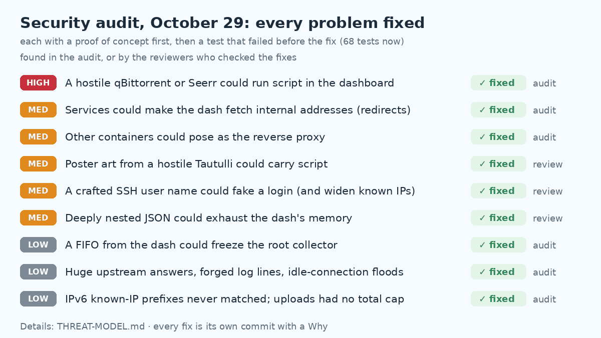

# homelab-dash 🫧

A glanceable dashboard for a self-hosted server: service status, Plex streams, media requests,
torrents + VPN-leak check, a live **"what's eating my CPU" breakdown**, a **live temps/power window**, drive health,
and a **security & backups** panel with full detail views. Three switchable themes (Bubbles, Miku, Gura).
One small stdlib-Python app (no pip, no Node, no database), ~25–40 MB RAM.

**▶ Live demo: [demo.vicy.us](https://demo.vicy.us)** (fake data; try **⚡ breakdown**, **🌡 live**, a Security box's
title, the 🎨 theme button, the ⚙ settings page and the wall-mode button)


| Light | Full page |
|---|---|
|  |  |

*(Screenshots are demo mode: fake data, Blender open-movie titles.)*

## What's new (October 2026)

⭐ = a big one, with a picture.

### ⭐ Security audit and hardening (Oct 29)

A full audit of the dashboard and the root collector: a [threat model](THREAT-MODEL.md), a working proof of concept for
each problem found, then a fix with a test that failed before it (68 tests in `tests/`, stdlib only). Five separate
reviewers (security, correctness, UI, and two for the root collector, one of them only trying to break it) then
checked the fixes, found a few more problems, and those are fixed and tested too.



The big ones:

- **A taken-over qBittorrent or Seerr could run script in your dashboard.** A few numbers and ids from them went into
  the page unescaped, and the Content-Security-Policy allowed inline script, so a hostile answer could act as you
  (the proof of concept quietly added a whole IP range to the known list). Now the server passes on only typed,
  clipped fields, the page escapes every value (numbers too), and the CSP is strict: scripts only from the
  dashboard's own files, no inline script or `onclick` anywhere. The fonts are self-hosted, so the page loads nothing
  from Google either.
- **A service can't send the dashboard to internal addresses any more.** Health checks and icon fetches followed
  redirects anywhere, and `/api/icon` handed back whatever it found there; the integrations would even have carried
  Seerr's API key along. Redirects to another host are no longer followed (a redirect still counts as "up").
- **Other containers can be locked out completely.** The "only my proxy" check is by source address, on a Docker
  network other containers share. The new `LISTEN` setting lets the dash answer only on a network that the proxy alone
  shares with it ([how](docs/SETTINGS.md#lock-the-dash-to-the-proxy-listen)), and a client that isn't the proxy is
  now dropped before the server even starts a thread for it (no more tying up the dash with idle connections).
- **Found by the reviewers:** poster art from a hostile Tautulli could carry script (now raster images only, with a
  no-script policy); a crafted SSH user name could fake a login on the card and, through "Add all", trust a whole IP
  range (the card now uses the same strict parser as the detail view, and only full addresses can be added);
  deeply nested JSON could exhaust memory even under the size caps (answers with more values than any real one are
  refused before parsing).
- **The dashboard can't stall the root collector.** A FIFO or symlink planted in the dash's request folder used to
  freeze the collector's main loop (every tile goes stale) or make root open a file of the dash's choosing.
- Smaller ones: answers from qBittorrent, Seerr and Tautulli are size-capped (a 150 MB answer pushed the dash past its
  memory cap); the container log escapes control characters and only believes the proxy about who sent a request;
  IPv6 prefixes in the known-IP list now match however they're written; uploads are limited to 200 files / 100 MB;
  if the SSH log can't be read, the card says "as of …" instead of looking like a quiet day.

### ⭐ Much lighter on the network and the CPU (Oct 29)


- **Torrents: 37.6 MB → 0.3 MB a minute.** The dash fetched qBittorrent's whole torrent list (3 MB for 1,500
  torrents) every 4 seconds to show the few active ones. It now uses qBittorrent's incremental feed (what its own web
  UI does): the full list once, then only what changed (~24 KB).
- **The root collector reads the SSH log once a minute, not three times, and ~10× cheaper each time** (`journalctl -n`
  walked the whole 2 GB journal). Once a minute every tile used to wait 9 seconds for the security checks; now ~6.
- **Everything the server sends is compressed** (the proxy only compressed HTML): `/api/system` 13.8 → 3.2 KB per poll.
  Reloads get "not modified" for every file that didn't change.
- **Miku's equalizer and the pulsing "down" badge run on the GPU** (they used to repaint 60 times a second): the wall
  view is as cheap in Miku, or with a service down, as plain Bubbles. Same look.

### ⭐ Security & backups: a detail view for every box (Oct 29)


Click any box's title on the Security & backups card (or open `/?security=ssh`) for the full picture behind its
one-line status, in a window with a tab per box:

- **Firewall & fail2ban**: status, default policy, every rule, every jail with its banned IPs, the week's bans.
- **SSH logins**: grouped by user, IP **and the key that was used** (matched to your `authorized_keys` comments), so
  one rare login can't hide behind thousands of routine ones. Failed attempts and scans by IP.
  **New:** the yellow "not on your list" tag is a button: click it (or "Add all") to put a trusted place on your
  known-IP list. Only IPs that really logged in can be added.
- **Authelia**: sign-ins and lockouts straight from its database.
- **Process watch**, **Cron jobs** (every line marked approved or not), **Immutable files** (each lock's flags).
- **Backups**: each job's last success, what it did, how long it took, its files, destination size and free space.


The views are read-only: the dashboard runs no commands. The root collector gathers everything once a minute
and the page only reads the result.

### ⭐ Security fixes

Most of these were found by separate security reviewers while the detail views were built. All are fixed and covered by tests:

- **The crypto-miner watch couldn't be dodged any more.** It used to skip every process with "homelab-dash" in its
  command line (the repo is public, so a miner could simply name itself that). It now skips only the collector's own PID.
- **Authelia's database is read defensively.** Its folder is writable by the Authelia container, so the root collector
  never lets SQLite open anything there: it reads the file's bytes (no symlinks, no FIFOs, size-capped) into an
  in-memory copy and queries that with SQLite's defensive settings (no triggers, no views, untrusted schema), real
  tables only, with row and time limits. A tampered database can't make root run SQL or hang.
- **Crafted log lines can't stall the collector.** Giant Authelia log lines used to make its regex take minutes per
  round; they're skipped now. SSH log reads are capped (a connection flood can't make them huge), and log files are
  opened non-blocking and must be regular files, so a FIFO planted in a log folder can't freeze the details.
- **User names can't fake an IP.** SSH user names can contain spaces (even "x from 192.0.2.5 port 1"), so the IP is
  read from the end of the line and must be a real address.
- **More secrets masked** in the cron and log lines the card shows: `curl -u user:pass`, `sshpass -p`,
  `smbclient -U user%pass`, API-key and cookie headers, short `?key=` / `?token=` values.
- **SSH key fingerprints are computed in Python**, instead of running `ssh-keygen` on a file the user controls.
- **Safe "add to known IPs"**: the server only accepts IPs from its own login data, so a forged request can't trust an attacker.
- **Settings can't be crashed** (Oct 22): fuzzing the validator with 20,000 broken inputs found ~4,200 that crashed it;
  each now gets a clear error message instead.
- **"Looks fine" can only clear real logins** (Oct 17): the acknowledgement keys are computed on the server, never sent by the browser.

### ⭐ Three themes, switchable with one click (Oct 18, Gura on Oct 28)

| Gura (light) | Gura (dark) |
|---|---|
|  |  |


**Bubbles** (the default), **Miku** (teal twin-tails, VU-meter bars, floating notes, an equalizer by the clock) and
**Gura** (a sunlit lagoon in light mode and the deep in dark mode: a shark-hood header with teeth, a little shark
swimming behind the title, bubbles that are sometimes a shark, an "a" or a shrimp). Press **T** or 🎨 to switch; the
choice is remembered per browser. See [Themes](#themes).

### ⭐ Live window: temps, power, clocks and disks, every second (Oct 23)


Click **🌡 live** on the Temperatures panel (or open `/?live`): a browser version of a terminal temps dashboard.
CPU temperatures, package power (from the CPU's own energy counter), usage, clock and memory, each with a one-minute
trend and its peak; the GPU; disk I/O with the busiest drives; and every CPU thread's load and clock, grouped by CCD.
It polls once a second only while it's open, and the layout never jumps while the numbers change.

### ⭐ Services: compact shelves, badges only on problems (Oct 28)

With 50+ services the panel had become the biggest thing on the page. Groups now sit on "shelves" sized for two
rows of tiles, healthy tiles stay quiet (no green dot on every one), and a service that's down gets a red "!" badge,
a tinted tile and "· down" after its name, so it isn't marked by colour alone. The panel is about a third shorter
and the wall view fits any number of groups (see the screenshots above).

### ⭐ The wall view uses about a fifth of the CPU (Oct 22)

A wall display shows the dashboard all day, so its cost adds up. Measured in headless Chrome at 1920×1080:
**~110% → ~19% of a core** (Bubbles) and **~114% → ~26%** (Miku), with the same look. The card blur behind the
drifting bubbles was re-rendered every frame (now gone), the header stripe slides on the GPU, panels skip redraws
that change nothing, refreshes never overlap, and everything pauses in a hidden tab. The server shares in-flight
refreshes between browsers and re-reads files only when they change.

### Smaller updates

- **Hide panels** you don't use (Oct 29): tick them off on the settings page; their summary tiles at the top stay.
- **Docs** (Oct 29): [ARCHITECTURE.md](ARCHITECTURE.md) (which file does what), a [settings reference](docs/SETTINGS.md),
  the [threat model](THREAT-MODEL.md) and the measured [performance baseline](PERF-BASELINE.md). The page script is
  now one file per panel.

- **Plex Now Playing**: "+N more" gives it the whole row when more people watch than fit; on the wall the list
  scrolls inside its box, and clicking the Plex tile expands or collapses it (Oct 18).
- **SSH logins**: a "Looks fine ✓" button clears the unknown-login alert; a new unfamiliar login flags again (Oct 17).
- **CPU / memory breakdown** shows containers' real memory (the figure `docker stats` shows), not the sum of their
  processes: nginx's 34 workers no longer add up to 1.4 GB (Oct 23).
- **Health checks through the proxy** can use a path (e.g. `pass.example.com/api/alive`) when `/` sits behind a login (Oct 28).
- The **header** stays on top while you scroll (Oct 21); the System card says "N running · M stopped" (Oct 22);
  the Security card's "log" and "banned IPs" dropdowns stay open across refreshes (Oct 20).
- The live button got an SVG thermometer (Oct 28); a theme's tagline hints on the settings page show its own default (Oct 28);
  on shorter screens the wall view keeps Services at full height (Oct 28).
- Earlier: a custom tab icon setting, backup log checks, SVG icons from the data folder (Oct 15).

## ⚡ Spotlight: what's eating my CPU?


Ever wondered why your fans spun up? Click **⚡ breakdown** (or the CPU tile) and get a **live, animated treemap of
everything using your machine**, grouped the way you think about it:

- **One tile per container** (Plex, qBittorrent, Immich…) and per program on the host (dockerd, your desktop, that
  rogue script). Bigger tile = more CPU. Tiles glide and resize as the load moves, every few seconds.
- **Flip to Memory** to see who's hoarding RAM instead.
- **Click a tile** for its CPU in cores, memory, process count, a live sparkline, and the **busiest processes inside it**:
  watch "Plex Transcoder" light up the moment someone starts a transcode.
- Counts *every* process on the box, not just containers, so nothing hides. Costs about 6 ms every 5 seconds.
- Deep-link it: `https://your-dash/?breakdown`. [Try it on the demo](https://demo.vicy.us/?breakdown).

Needs the (optional) root collector; see Install.

## Features

- **Services, automatically.** Reads Nginx Proxy Manager's proxy host files, so every host you add in NPM
  shows up on its own, health-checked every 30 s, with icons from [dashboard-icons](https://github.com/homarr-labs/dashboard-icons).
  Hover a tile to see whether it's behind SSO (Authelia/Authentik) or public. Not using NPM? List services in `config.toml`.
- **Plex Now Playing** (via Tautulli): who's watching what, direct play vs transcode, HW vs CPU, home vs remote.
  Poster art is proxied, so your Plex token never reaches the browser. More viewers than fit? **"+N more"** gives
  Now Playing the whole row (Requests steps aside until you click "show requests"), and on the wall the list scrolls.
- **Requests** (Seerr / Overseerr / Jellyseerr): approve or decline right from the dashboard.
- **qBittorrent**: downloads, seeding, speeds, and a big red banner if it ever shows your real home IP (VPN leak).
- **System**: CPU per thread, RAM, network, temperatures (AMD, Intel, DDR5, NVMe), NVIDIA GPU incl. NVENC/NVDEC.
- **🌡 Live window**: temps, package power, clocks, memory and disk I/O every second, with one-minute trends (see above).
- **⚡ CPU / memory breakdown**: a live treemap of every container and host program, with per-process detail (see above).
- **Drives**: usage + SMART health/temps for every disk, without waking sleeping drives.
- **Security & backups**: fail2ban, SSH logins from unknown IPs, Authelia failures, crypto-miner watch,
  crontab change detection with a one-click "Looks good" approval, `chattr +i` lock checks, backup freshness.
  Click a box's title for its **details**: firewall rules and bans, who logged in over SSH (with the key
  they used), Authelia sign-ins and lockouts, every cron line marked approved or not, each backup job's last run,
  size and free space. Deep link: `https://your-dash/?security=ssh`.
- **Wall mode**: `https://your-dash/?wall` fits a 1920×1080 screen with no scrolling and hides the cursor.
  Click the Plex tile there to expand or collapse Now Playing; the stream list scrolls inside its own box.
- **Themes**: Bubbles, Miku and Gura, each with its own mascot, lines and tab icon (see below).
- Light/dark automatic, floating bubbles, optional mascot. Every panel is optional and hides itself if not configured.

## Themes

- **Switch** with the 🎨 button or the **T** key. The choice is saved per browser, so a wall display can keep its own
  theme. The default for new visitors is set on the settings page.
- **Each theme has a personality**: mascot, greeting, quotes, click emoji, taglines and tab icon. Miku and Gura bring
  their own defaults; anything you set for a theme on the settings page wins. Bubbles uses the top-level fields.
- **Light and dark** follow your system, in every theme.
- **Light on CPU**: no backdrop blur; the drifting bubbles, the header stripe and Gura's rays and shark move with
  `transform` (cheap for the GPU), and everything stops with "reduce motion".
- **Adding one**: add its id and defaults to `THEMES` in `app/settings.py` and its styles to `app/themes.css`, all scoped
  under `html[data-theme="<id>"]`. The themes ship no character artwork; mascots are your own uploads.

## How it fits together

```
browser ──► reverse proxy + SSO ──► dash container (uid 1000, read-only, no capabilities)
                                       │  reads (read-only):  NPM proxy_host/*.conf, /proc, hwmon,
                                       │                      hw.json + sec-detail.json
                                       │  calls with API keys: qBittorrent, Seerr, Tautulli
                                       ▼
     /var/lib/homelab-dash/hw.json, sec-detail.json  ◄── homelab-dash-collector (root systemd service, no network)
                                                         smartctl · nvidia-smi · fail2ban · journal · cron · lsattr · ufw
```

The part exposed to the network has no power; the part with root never talks to the network.
API keys live only in `.env` on the server; the browser only ever talks to the dashboard's own backend.
The one write path from the dash to root is the cron "Looks good" button: it drops a hash into a folder, and the
collector approves only if that hash matches the crontabs as they are right now.

## Try it (demo mode, fake data)

```sh
git clone https://github.com/CoreXI7/homelab-dash && cd homelab-dash
DEMO=1 python3 app/app.py          # Python 3.11+, then open http://localhost:8000
```

## Install

1. **Dashboard**
   ```sh
   mkdir data && sudo chown 1000:1000 data     # settings, saved keys and uploads live here
   cp .env.example .env && chmod 600 .env      # optional: keys can be typed on the settings page instead
   # edit docker-compose.yml: ORIGIN, TRUSTED_PROXY, your NPM folder and your proxy's Docker network
   docker compose up -d
   ```
   Add a proxy host for it in NPM (forward to `dash:8000`) and put it behind your SSO.
   Then open the dashboard, click ⚙, and set everything else there.

2. **Collector** (optional, for drives, GPU, disk temps, security and backups)
   ```sh
   sudo bash collector/install.sh
   sudo nano /etc/homelab-dash/collector.toml   # mounts, fail2ban jail, backup log, ...
   sudo systemctl restart homelab-dash-collector
   ```
   Needs Python 3.11+ on the host. Uses `smartctl` (smartmontools), and `nvidia-smi`, `fail2ban-client`,
   `docker` if present. With every security check on, it costs well under a second of CPU a minute (measured on a
   32-thread box with a busy 2 GB journal; it was 4.5 s before Oct 29). Uninstall: `sudo bash collector/install.sh --uninstall`.
   It's configured by file on purpose: it runs as root, so a web page shouldn't be able to change what it does.

Every setting (settings page, environment, collector) is listed in [docs/SETTINGS.md](docs/SETTINGS.md).

### Tests

```sh
python3 -m unittest discover -s tests       # stdlib only; the page tests use headless Chrome if it's installed
```

Each security fix has a test that failed before it; the fakes in `tests/helpers.py` stand in for qBittorrent, Seerr,
Tautulli and any web app, so nothing real is contacted.

## Settings page


Click ⚙ on the dashboard (or open `/settings`):

- **Look & feel**: title, default theme, and per theme its taglines, click emoji, mascot (upload an image), what the mascot says.
- **Services**: everything found in NPM, with groups you can create, rename and reorder, labels, icons
  (any [dashboard-icons](https://dashboard-icons.homarr.dev) name), and hiding. New NPM hosts appear on their own.
- **Extra services** that aren't in NPM (NAS, router, ...), health-checked too.
- **Integrations**: qBittorrent, Seerr/Overseerr/Jellyseerr, Tautulli, with a Test button.
- **Trusted IPs** for the SSH/SSO login check (or add them from the SSH detail view).

Changes apply immediately, no restart. They're saved to `data/settings.json`; keys to `data/secrets.json` (both `chmod 600`).
Prefer files? Put a `config.toml` (see [`config.example.toml`](config.example.toml)) in `data/`; it's used until the first save.

## Host a public demo

[`docker-compose.demo.yml`](docker-compose.demo.yml) runs a demo with fake data that's safe to leave open to the internet:
no secrets, no host access, no outbound connections, a settings page that never saves, uploads off, and tight
CPU/RAM/process/log limits. It sits on an internal network that only your reverse proxy joins:

```sh
docker compose -f docker-compose.demo.yml up -d
docker network connect homelab_demo <your-proxy-container>   # e.g. nginx for Nginx Proxy Manager
```

Then add a proxy host for it (forward to `homelab-demo:8000`), with no SSO.

## Security notes

**Your API keys never leave the server.**
- Keys live only on the server: in `data/secrets.json` (`chmod 600`) or `.env`. The settings page is write-only for keys:
  you can type a new one, but it only ever shows "saved", never the value.
- Changing an integration's address requires typing its key again in the same save, so someone who got into the
  settings page can't redirect your stored key to their own server. Keys set in `.env` lock their address too.
- **Test** only uses the saved address, never one typed into the form. The browser only ever talks to the dashboard's own
  backend, which calls qBittorrent, Seerr and Tautulli for it. No endpoint returns a key, a password, or an upstream URL.
- Every error message is scrubbed before it reaches the browser or the container log (Python errors can echo
  request URLs, and Tautulli's key travels in its URL). Unexpected errors return a generic message.
- Plex posters are proxied through Tautulli, so your Plex token isn't exposed either.
- Your `known_ips` list stays on the server; the page only gets a "known / unknown" flag per login.
- The collector redacts passwords, tokens, webhook URLs and `user:pass@` from cron and log lines before writing
  `hw.json` and `sec-detail.json`, and those files are readable only by root and the dash container's group.

**Who can use it.**
- Run it **behind SSO** (Authelia, Authentik, ...). The app has no login of its own, so anyone who gets past your SSO
  can change settings. Set `SETTINGS_UI=0` to make the settings page read-only.
- What protects the dashboard itself (allowed origin, trusted proxy, NPM folder) is set in `docker-compose.yml`,
  never on the settings page. So is everything about the root collector.
- Everything typed into the settings page is validated on the server (lengths, URL schemes, icon names, IPs).
  Uploads must really be PNG/JPEG/GIF/WebP (checked by content, not name); SVG is refused because it can carry scripts.
- `trusted_proxy` (default `nginx`; several names or IPs allowed) makes the app drop any connection that isn't from
  your reverse proxy, before it starts a thread for it, so another container on the same Docker network can't skip
  the SSO. With `LISTEN` it answers only on a network the proxy alone shares with it, so a container that fakes the
  proxy's address can't reach it either ([how](docs/SETTINGS.md#lock-the-dash-to-the-proxy-listen)).
- Every POST (saving settings, uploads, approve/decline, cron approval, adding a known IP) requires the browser's
  `Origin` to be the dashboard itself (`ORIGIN`, or its own Host if unset). That blocks other websites from acting for you (CSRF).
- Everything from outside (torrent names, Plex titles, Seerr usernames, hostnames) is HTML-escaped before it's shown,
  numbers included, and the server passes on only typed, clipped fields. The Content-Security-Policy allows scripts
  only from the dashboard's own files (no inline script or event handlers), and fonts and styles only from itself.
- Icons are fetched only from hosts the dashboard already knows (no open proxy). No outbound request follows a
  redirect to another host, and answers are capped in size and in number of JSON values. Poster art passes only as a
  raster image under a no-script policy. Static files can't escape `app/static/`.
- The container log escapes control characters and names the sender from the proxy's headers only when the request
  really came from the proxy.
- The container runs as uid 1000 with a read-only filesystem, all capabilities dropped, and 256 MB / 128 process caps.
- The root collector never listens on the network. The only thing the dash can ask of it is "approve the cron jobs
  as they are right now", checked by hash, and that request file is read without following symlinks or waiting on a
  FIFO. Authelia's database (its folder is writable by the Authelia container) is
  read without following symlinks or blocking on FIFOs, and log tails must be regular files.

What it can't protect against: anyone with Docker or root access on the host can read the container's environment
(`docker inspect`), like with any self-hosted app. Keep `.env` at `chmod 600` and don't commit it (`.gitignore` covers it).

## License

MIT
