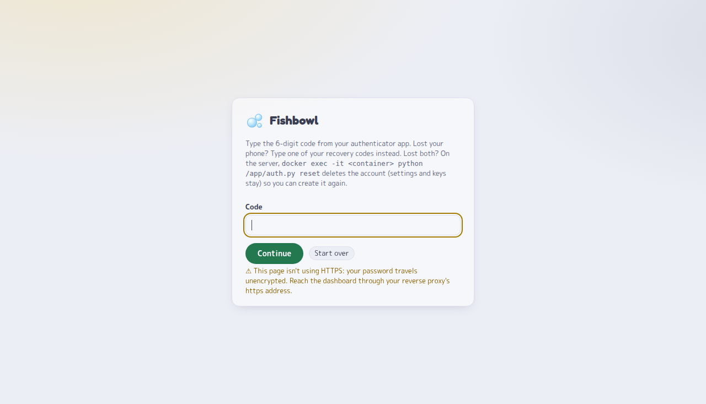
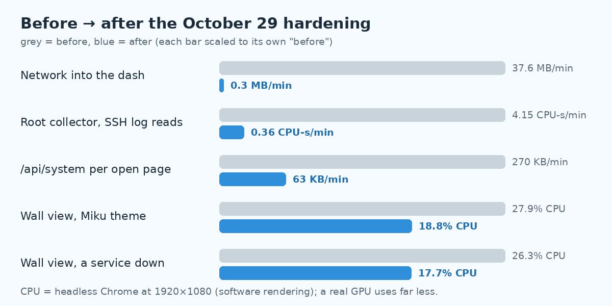

# Fishbowl 🐟🫧

*Your whole server in a fishbowl.*

**One page that tells you if your home server is OK.** Services up or down, who's watching Plex, pending requests,
torrents with a VPN-leak alarm, temperatures, drives, security and backups, all at a glance, on any screen.

- **Small.** One Python app, standard library only: no pip, no Node, no database. About 25–40 MB of RAM.
- **Easy.** After `docker compose up -d`, everything is set up from a settings page, and its **Setup checklist** tells
  you what's missing and how to fix it. Services from Nginx Proxy Manager show up on their own.
- **Safe.** Its own sign-in with an optional authenticator app, your API keys never reach the browser, and the part
  that runs as root never touches the network. Version 1.0 went through a four-round security audit before release:
  [the results](#security).

**▶ [Try the live demo](https://demo.vicy.us)** (fake data; nothing you do there is saved)


*Screenshots use demo mode: fake data, Blender open-movie titles.*

---

## Contents

- [Highlights](#highlights)
- [Everything it shows](#everything-it-shows)
- [Quick start](#quick-start)
- [Signing in](#signing-in)
- [Using it: keys, clicks and links](#using-it-keys-clicks-and-links)
- [Settings](#settings)
- [Updating](#updating)
- [Security](#security), including [the 1.0 security audit](#the-10-security-audit)
- [Host a public demo](#host-a-public-demo) · [Tests](#tests) · [More docs](#more-docs) · [License](#license)

---

## Highlights

### 📺 Made for a screen that's always on

**Wall mode** (press **W**) fits a 1920×1080 screen with no scrolling and hides the cursor. Healthy things stay quiet;
what needs you stands out: a down service gets a red **!**, a VPN leak gets a big red banner.

| Light | The full page |
|---|---|
|  |  |

### ✅ A Setup checklist that fixes your install for you


The settings page checks your whole setup: the reverse proxy and its headers, the dashboard's address, whether
settings can be saved, the Nginx Proxy Manager folder, whether a sign-in protects the dashboard, the collector, the
integrations. Each problem says what happens if you ignore it and gives the exact fix, with a **Copy** button.

### 🔑 Its own sign-in, with two-step and a "someone knows your password" alarm

| Sign in | Two-step code | Settings → Account |
|---|---|---|
|  |  |  |

One account, a long password (no silly rules), an optional authenticator app with 10 one-time recovery codes, and
"keep me signed in" for wall screens. If someone types your **right password without the right code**, Fishbowl tells
you at your next sign-in, and the Setup checklist keeps saying so until you change the password or press "That was
me". Already have SSO (Authelia, Authentik)? `AUTH: proxy` turns Fishbowl's own sign-in off.

### 🛡 Security & backups, with the full story one click away


fail2ban bans, SSH logins from places you don't know (grouped by user, place and key, so one odd login can't hide among
thousands), Authelia failures, a crypto-miner watch, changed cron jobs, locked files, and whether last night's backup
ran. Click any box's title for every detail behind it.


### 🌡 A live window and a live breakdown

| Live window | Breakdown |
|---|---|
|  |  |

**🌡 live** shows temperatures, package power, clocks, memory, the GPU, disk I/O and every CPU thread, every second
(and costs nothing when closed). **⚡ breakdown** is a live map of what's using your CPU or memory, one tile per container
or program.

### 🔒 A VPN-leak alarm for your torrents

qBittorrent's downloads and speeds, plus a big red banner the moment your torrent client shows your real home IP.

### 🎨 Three themes, light and dark

| Gura (light) | Gura (dark) |
|---|---|
|  |  |


**Bubbles** (the default), **Miku** and **Gura**, each with its own colours, motion, greetings and quotes, light and
dark with your system. Press **T** to switch. Mascots are your own uploads (themes ship no character art).

### ⚡ Light on your server



qBittorrent sends only what changed, everything is compressed, the animations run on the GPU, and the root collector
uses under a second of CPU a minute. Measured numbers: [PERF-BASELINE.md](PERF-BASELINE.md).

---

## Everything it shows

| Panel | What it shows |
|---|---|
| **Services** | Every proxy host in Nginx Proxy Manager, with an icon, checked every 30 s, on compact shelves by group. Not using NPM? Add services on the settings page. |
| **Plex Now Playing** | Who's watching what, direct play or transcode, home or remote (via Tautulli). |
| **Requests** | Seerr / Overseerr / Jellyseerr requests, with **Approve** and **Decline** buttons. |
| **Torrents** | qBittorrent downloads and speeds, and the VPN-leak alarm. |
| **System** | CPU per thread, RAM, network, temperatures, NVIDIA GPU incl. NVENC/NVDEC. |
| **⚡ Breakdown** | What's using your CPU or memory, live. |
| **🌡 Live window** | Every-second temps, power, clocks, memory and disk I/O. |
| **Drives** | Space used, SMART health and temperature, without waking sleeping disks. |
| **Security & backups** | Firewall, fail2ban, SSH logins, Authelia, miner watch, cron changes, locked files, backups, each with a details view. |

Every panel is optional: unconfigured ones hide themselves, and you can hide any panel on the settings page.

> Drives, the GPU, package power and the Security & backups panel come from the optional **root collector**
> ([step 2 below](#2-the-collector-optional)). CPU and board temperatures work without it.

---

## Quick start

### Just look (demo mode, no setup)

```sh
git clone https://github.com/CoreXI7/fishbowl && cd fishbowl
DEMO=1 python3 app/app.py          # Python 3.11+, then open http://localhost:8000
```

### 1. The dashboard (Docker)

```sh
git clone https://github.com/CoreXI7/fishbowl && cd fishbowl
mkdir data && sudo chown 1000:1000 data     # your settings, saved keys and uploads live here
cp .env.example .env && chmod 600 .env      # needed, but can stay empty: keys can be typed on the settings page
```

Open `docker-compose.yml` and set four things: `ORIGIN` (your dashboard's URL), `TRUSTED_PROXY` (your reverse proxy's
container name), the path to your NPM `proxy_host` folder, and your proxy's Docker network. Then:

```sh
docker compose up -d
```

In your reverse proxy, add a host that forwards to `dash:8000` over HTTPS. With **Nginx Proxy Manager**, put
`set_real_ip_from 127.0.0.2/32;` under **Advanced** and turn on **Force SSL** (otherwise a visitor can choose the address
the dashboard sees). Caddy, HAProxy and Traefik: [the lines they need](docs/SETTINGS.md#signing-in-auth-login-the-default).

Open the dashboard. The first time, it asks you to create your account with a one-time **setup code** from the
container's log:

```sh
docker logs dash 2>&1 | grep "^SETUP CODE" | tail -n 1
```

Then click **⚙**: the **Setup** checklist checks the rest.

> **Empty page or 502?** Run `docker logs dash`: a `TRUSTED_PROXY` name that doesn't resolve refuses everyone, and the
> log says so. Not sure of your proxy's network? `docker inspect -f '{{range $k,$v := .NetworkSettings.Networks}}{{$k}} {{end}}' <proxy>`

> **Recommended:** set `LISTEN` so the dashboard answers only on a network your proxy alone shares with it, and no
> other container can reach it: [how](docs/SETTINGS.md#lock-the-dash-to-the-proxy-listen).

### 2. The collector (optional)

The collector reads drives, the GPU, power and the security checks on the host, as root, and writes them to a file the
dashboard reads. It never talks to the network.

```sh
sudo bash collector/install.sh
sudo nano /etc/homelab-dash/collector.toml   # your drives, fail2ban jail, backup jobs, ...
sudo systemctl restart homelab-dash-collector
```

It needs Python 3.11+ and `smartctl`; it also uses `nvidia-smi`, `fail2ban-client` and `docker` if they're there. The
installer tries it under three systemd sandboxes and keeps the strictest one under which it still sees everything.
Remove it with `sudo bash collector/install.sh --uninstall`. (It keeps Fishbowl's old name, homelab-dash, in its
service and folders.)

Most of its settings can also be changed on the settings page. Switches apply by themselves; anything that makes root
read a file or run a search (log files, backup jobs, patterns) waits until you approve it on the host with
`sudo homelab-dash-collector --apply`, which shows exactly what changes.

---

## Signing in

Fishbowl has its own sign-in, on by default: one account, for you.

- **First run:** the account can only be created with the newest setup code from the container's log, so nobody who
  finds a fresh install before you can claim it. Anyone who can read that log (Dozzle, Portainer, a log shipper) can
  read the code too: create the account right after the first start.
- **Password:** 15 characters or more (a few random words work well), checked against common passwords, stored with
  scrypt. No other rules; password managers and pasting are welcome.
- **Two-step sign-in** (recommended): ⚙ → **Account** → set up an authenticator app, and keep the 10 recovery codes it
  shows (each works once, for a lost phone).
- **Keep me signed in:** 30 days (7 without a visit), so a wall screen stays up. Without it: 12 hours (1 hour without a
  visit).
- **⚙ → Account:** confirm it's you, then change the password (which signs every other browser out), turn two-step on
  or off, make new recovery codes, see and sign out the signed-in browsers, and see recent sign-ins and failed tries.
- **Guessing:** after 5 wrong tries the waits double, up to 15 minutes. After 100 in a row, browsers that never signed
  in are locked out until you run `auth.py unlock` on the host; browsers you've signed in with before still get in.
  Your next sign-in tells you what failed since the last one.
- **Plain HTTP:** passwords are only accepted from your own network, and that sign-in only works from the same address.
  Your browser sends the dashboard's cookies to every other web app on that address (any port), so over plain HTTP only
  run apps you trust next to it, or use HTTPS on a host name of its own.

**Forgot the password, locked out, or lost a device?** On the host:

| `docker exec -it dash python /app/auth.py ...` | What it does |
|---|---|
| `status` | The account, the lock, two-step, recovery codes left, signed-in browsers |
| `unlock` | Ends the lock after 100 wrong tries |
| `signout` | Signs every browser out and forgets trusted browsers; the account stays |
| `reset` | Deletes the account and every session (settings and keys stay) and prints a new setup code |
| `setup-code` | A new setup code, while there's no account yet |

**Already have SSO** (Authelia, Authentik, an access list)? Add `AUTH: proxy` to the `environment:` in
docker-compose.yml so you sign in only once. It needs `TRUSTED_PROXY` too: without it anyone could go around your
proxy's sign-in, so Fishbowl keeps its own on and says so. Don't let your SSO wave any of the dashboard's paths through
(an Authelia `bypass` rule for `^/api` that covers its host, say): with `AUTH: proxy`, whoever gets past the proxy can
change everything.

Every detail: [docs/SETTINGS.md](docs/SETTINGS.md#signing-in-auth-login-the-default).

---

## Using it: keys, clicks and links

| Do this | To get |
|---|---|
| **T** or 🎨 | Switch theme (remembered per browser, so a wall screen keeps its own) |
| **M** or 🫧 | Background motion on or off in this browser (by default it follows your device's reduce-motion setting) |
| **W** or the monitor button | Wall mode |
| Click **⚡ breakdown** or the CPU tile | What's using the machine; click a tile for its busiest processes |
| Click **🌡 live** on Temperatures | The every-second live window |
| Click a **box title** on Security & backups | The full details behind that box |
| **Esc** | Close any of these windows |

Every window has its own link, handy for bookmarks or a second screen:
`/?wall` · `/?breakdown` · `/?live` · `/?security=ssh` (also `fw`, `auth`, `procs`, `cron`, `locks`, `backups`) · `/settings`

---

## Settings


Click **⚙** (or open `/settings`). Use the side menu or search; changes apply right away, no restart. **Ctrl+S** saves.

| Section | What's there |
|---|---|
| **Setup** | What's working and what isn't, each with its fix |
| **Look & feel** | Title, and which panels to show |
| **Themes** | The default theme and background motion; per theme its mascot, tab icon, taglines and lines |
| **Services** | Everything found in NPM: groups, labels, icons (any [dashboard-icons](https://dashboard-icons.homarr.dev) name), hiding. Services not in NPM. Advanced: services to check through the proxy |
| **Integrations** | qBittorrent, Seerr / Overseerr / Jellyseerr, Tautulli, each with a **Test** button that says what's wrong |
| **Drives & hardware** | Which drives to show and their names, the network interface, the GPU, the update interval |
| **Security** | Your own IPs (their logins aren't flagged), and what the collector watches |
| **Backups** | Your backup log, what counts as OK or failed, backup jobs, counted checks and file patterns |
| **Account** | With Fishbowl's own sign-in: password, authenticator app, recovery codes, signed-in browsers, recent sign-ins |
| **About** | What's set in `docker-compose.yml`, and why it can't be changed here |

Everything is saved in `data/` (`settings.json`, keys in `secrets.json`, both `chmod 600`). Prefer a file? Put a
`config.toml` in `data/` (see [`config.example.toml`](config.example.toml)); it's used until the first save.
Security settings (`ORIGIN`, `TRUSTED_PROXY`, `LISTEN`, `AUTH`, `SETTINGS_UI`, …) live in `docker-compose.yml`,
never on the page. **Every setting: [docs/SETTINGS.md](docs/SETTINGS.md).**

---

## Updating

```sh
git pull
docker compose up -d --force-recreate     # without --force-recreate the old code keeps running
sudo bash collector/install.sh            # only if you use the collector: it runs on the host and updates separately
```

The Setup checklist says when the dashboard needs a restart for new code, and when the collector is older than the
dashboard. If `git pull` refuses because you edited `docker-compose.yml`: `git stash`, `git pull`, `git stash pop`, and
look over the merged file. If `git stash pop` reports a conflict, keep your lines and the new ones, then
`git add docker-compose.yml`, `git reset -q` and `git stash drop`. Next time, keep your changes in a
`docker-compose.override.yml` next to it (Compose reads it on top; git leaves it alone).

**Coming from a version before 1.0** (homelab-dash):

| What changed | What to do |
|---|---|
| **Fishbowl has its own sign-in, on by default.** | If your reverse proxy's sign-in already protects it, add `AUTH: proxy` to the `environment:`. Otherwise create your account with the setup code after updating. |
| **The security fixes from the 1.0 audit** include the root collector. | Run `sudo bash collector/install.sh` again. Over plain HTTP, everyone signs in once more. |
| **Clients that aren't your proxy are dropped**, and redirects from services are no longer followed. | Make sure `TRUSTED_PROXY` names your proxy (several names or IPs, space-separated, are fine). If an integration sits behind a redirect, point it at the real address: its **Test** button says so. |
| **The project is called Fishbowl now.** GitHub forwards the old address. | Optionally: `git remote set-url origin https://github.com/CoreXI7/fishbowl`. |
| **`.env` must exist.** | `cp .env.example .env`, even if it stays empty. |

---

## Security

```
browser ──► reverse proxy ──► dash container: its own sign-in (or your SSO) ── no root, read-only, no capabilities
                                       │  reads: NPM proxy hosts, /proc, the collector's files
                                       │  calls: qBittorrent, Seerr, Tautulli (keys stay here)
                                       ▼
                       /var/lib/homelab-dash/*.json  ◄── collector (root, never on the network)
```

**The part on the network has no power, and the part with root never talks to the network.**

- **Nothing without signing in.** Fishbowl's own sign-in (on by default) or your SSO. Sessions in HttpOnly, SameSite,
  `__Host-` cookies; growing waits after wrong tries; an alarm when someone has your password but not your code.
- **Keys never reach the browser.** The settings page can save a key but never shows it, and changing an integration's
  address means typing its key again, so nobody can send your saved key to their own server.
- **Only your proxy can talk to it** (`TRUSTED_PROXY`, and `LISTEN`), and every change must come from the dashboard's
  own page, so other websites can't act for you.
- **Everything from outside is untrusted:** a hacked qBittorrent, Seerr or Tautulli can't run script in your page, send
  the dashboard to internal addresses, or use up its memory. Every answer is escaped, size-capped, time-limited and
  checked.
- **The container** runs as uid 1000, read-only, all capabilities dropped, capped at 256 MB and 128 processes.
- **The collector** runs as root in a systemd sandbox, never on the network. It reads files the dashboard or other
  containers can write without following their links, and nothing the dashboard sends can make it read a file or run a
  pattern until you approve it on the host.

The limit, as with any self-hosted app: anyone with Docker or root access on the host can read the container's
environment. Keep `.env` at `chmod 600` and out of git (`.gitignore` covers it).

### The 1.0 security audit

Before 1.0 was released, Fishbowl went through a **four-round security audit**: 40 independent reviews by ten
specialist roles, each round with fresh reviewers who hadn't seen the earlier rounds' reasoning.

| | |
|---|---|
| **Who reviewed** | Ten roles, fresh in every round: the sign-in and sessions, the HTTP layer, the browser side, outbound requests (SSRF), the root collector, cryptography, a black-box red team that only had the README, fuzzing, research into new attack classes and past advisories, and release hygiene. |
| **How** | Every attack ran against throwaway copies (never a real install), on the host's Python **and** the exact pinned Docker image, behind real proxies (Nginx Proxy Manager, nginx, Caddy, HAProxy, Traefik) and in real browsers (Chrome and Firefox). Each round re-ran every earlier round's attack scripts. |
| **Fuzzing** | More than 15 million executions across the HTTP API in every sign-in mode, hostile fake services, and the collector's parsers, plus 660,000 differential runs against real `nginx -t`. |
| **Found** | 2 high and about 50 medium issues across the four rounds, every one of them **fixed before release**, each with a test that failed before the fix and passes after. The findings shrank every round: by round 4 no reviewer found a way in, only ways a hostile service could knock the dashboard over and rare setups (rootless Podman, IPv6-only networks) that weakened a rule. |
| **Tests** | 356 automated tests, plus a browser sign-in test of 44 checks and before/after screenshots of every page in every theme. |

**What it didn't cover, honestly:** this was a review by AI agents, not a paid third-party audit, and nothing is
formally proven. Safari, Podman, Cloudflare Tunnel and Tailscale weren't run for real. The trade-offs that remain are
written down in [THREAT-MODEL.md](THREAT-MODEL.md#still-open).

- **What was tested and every result:** [SECURITY-TESTING.md](SECURITY-TESTING.md) and [TESTING.md](TESTING.md)
- **How it's built to be safe:** [THREAT-MODEL.md](THREAT-MODEL.md)
- **Found something?** Please report it privately: [SECURITY.md](SECURITY.md)

---

## Host a public demo

[`docker-compose.demo.yml`](docker-compose.demo.yml) runs a fake-data demo that's safe to leave open: no secrets, no host
access, no internet, a settings page that never saves, uploads off, and tight resource limits.

```sh
docker compose -p fishbowl-demo -f docker-compose.demo.yml up -d
docker network connect homelab_demo <your-proxy-container>   # e.g. nginx for Nginx Proxy Manager
```

Then add a proxy host that forwards to `homelab-demo:8000`, with no SSO.

## Tests

```sh
python3 -m unittest discover -s tests       # stdlib only; page tests use headless Chrome if installed
```

Fake qBittorrent, Seerr, Tautulli and web apps stand in for the real ones, so nothing real is contacted. What's
covered and how: [TESTING.md](TESTING.md).

## More docs

- [docs/SETTINGS.md](docs/SETTINGS.md): every setting, its limits and defaults
- [ARCHITECTURE.md](ARCHITECTURE.md): which file does what
- [THREAT-MODEL.md](THREAT-MODEL.md): what it defends against, and what it doesn't
- [SECURITY-TESTING.md](SECURITY-TESTING.md) · [TESTING.md](TESTING.md): how it was tested, and the results
- [PERF-BASELINE.md](PERF-BASELINE.md): measured CPU, memory and network numbers
- Adding a theme: add its id and defaults to `THEMES` in `app/settings.py` and its styles to `app/themes.css` under
  `html[data-theme="<id>"]`

## License

MIT
