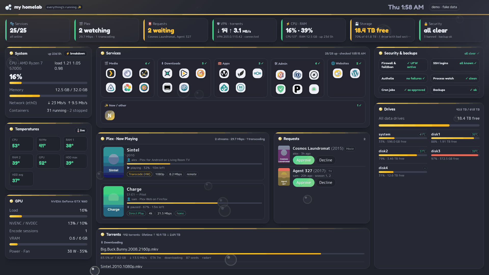

# Installing Fishbowl

The full version of the README's quick start: every step, the collector, and the keys and buttons.

## What you need

- A Linux server with Docker and Docker Compose
- A reverse proxy that gives the dashboard an HTTPS address (any one you already use is fine)
- Optional, for the collector: Python 3.11 or newer, systemd and `smartctl` on the server

## Install

### 1. Download Fishbowl

```sh
git clone https://github.com/CoreXI7/fishbowl
cd fishbowl
```

This gets the compose file and the optional collector. The dashboard itself runs from the image.

### 2. Create the data folder and the `.env` file

Fishbowl saves its settings in `data/`. The `.env` file can hold your API keys, but it can stay empty, since you can
also enter keys on the settings page later.

```sh
mkdir data
sudo chown 1000:1000 data
cp .env.example .env
chmod 600 .env
```

### 3. Edit `docker-compose.yml`

Open `docker-compose.yml` and change these lines to match your server:

- `ORIGIN`: the address you'll open the dashboard at, for example `https://dash.example.com`
- `TRUSTED_PROXY`: the container name of your reverse proxy (it's set to `nginx` by default)
- `networks`: the Docker network your reverse proxy is on (`reverse_proxy` by default)
- The `proxy_host` volume: the path to Nginx Proxy Manager's `data/nginx/proxy_host` folder. Delete this line if you
  don't use Nginx Proxy Manager.

### 4. Start it

```sh
docker compose up -d
```

### 5. Connect your reverse proxy

In your reverse proxy, send your chosen address (for example `dash.example.com`) to `dash`, port `8000`.

Your proxy also needs to pass on each visitor's real IP address, so Fishbowl can tell visitors apart. The exact lines
for each proxy are in [docs/SETTINGS.md](SETTINGS.md#signing-in-auth-login-the-default). The settings page will
remind you if this is missing.

### 6. Create your account

Open your dashboard's address. The first time, it asks for a one-time setup code. Get it from the container's log:

```sh
docker logs dash 2>&1 | grep "^SETUP CODE" | tail -n 1
```

Then choose a name and a password of at least 15 characters (a few random words work well).

Already have a login page in front of your services, like Authelia or Authentik? Then you can turn Fishbowl's own
sign-in off: add `AUTH: proxy` under `environment:` in `docker-compose.yml` and run `docker compose up -d` again.

### 7. Finish setup in the browser

Click the **⚙** button and open **Setup**. It checks your install and tells you how to fix anything that's missing.
Then connect your apps under **Integrations**: qBittorrent, Seerr and Tautulli each have a **Test** button.

### Optional: install the collector

The collector is a small helper that runs directly on your server, outside Docker. It reads things the dashboard
can't see from inside its container: drives, the GPU, power use, and security logs.

```sh
sudo bash collector/install.sh
sudo nano /etc/homelab-dash/collector.toml
sudo systemctl restart homelab-dash-collector
```

In `collector.toml`, list your drives and, if you use them, your fail2ban jail and backup log. To remove the
collector: `sudo bash collector/install.sh --uninstall`.

#### How the collector works

Some of what Fishbowl shows can only be read as root: SMART data from your drives, the firewall and fail2ban, the
SSH login log, scheduled jobs, and backup logs. Instead of giving the dashboard those powers, a separate program
does that part:

1. **It runs on the host as a systemd service,** as root, once every few seconds.
2. **It writes what it found to files** in `/var/lib/homelab-dash/`.
3. **The dashboard only reads those files.** They're mounted into its container read-only.

The collector never connects to the network. The installer tests it under three systemd sandboxes and keeps the
strictest one it still works under: no network at all, a read-only system apart from its own folder, and only the
root permissions it needs.

You can change most of its settings on the dashboard's settings page. Simple switches, like which drives to show,
apply by themselves. Anything that would make root read a file or run a search pattern, like a new log file to
watch, waits until you approve it on the server:

```sh
sudo homelab-dash-collector --apply
```

It shows exactly what will change and asks first.

## Using it

- **Settings:** click ⚙ (or go to `/settings`). Everything from your services to themes to your account is set there,
  and changes apply right away.
- **Two-step sign-in:** go to ⚙ → **Account** to add an authenticator app. Keep the recovery codes it gives you.
- **Locked out or forgot your password:** run `docker exec -it dash python /app/auth.py reset` on the server. It
  removes the account (your settings stay) and prints a new setup code.

Every setting is explained in [docs/SETTINGS.md](SETTINGS.md).

### Wall mode and buttons



Wall mode is made for a TV or spare monitor that stays on: everything fits one 1920×1080 screen, it stays calm while all
is well and stands out when something needs you. Turn it on with `W`, the 🖥 button, or `?wall` at the end of the address
(for a screen that opens the dashboard at startup). The cursor and buttons hide after 3 seconds without movement, and
the page reloads itself every 6 hours to keep the browser light.

| Key | Button | What it does |
|---|---|---|
| `W` | 🖥 (top right) | Wall mode on or off |
| `T` | 🎨 | Next theme, remembered by this browser |
| `M` | 🫧 | Background animation on or off, remembered by this browser |
| | ⚙ | Settings (`Ctrl+S` saves there) |
| | **live** on Temperatures | Live view: temperatures, power, clocks, disks and every CPU thread, updated every second |
| | **⚡ breakdown** on System | What's using the CPU and memory, by container and program |
| | A title in Security & backups | The details behind that check |
| | The Plex tile | Gives Now Playing the whole row |
| | **Downloading** / **Seeding** | Switches the torrent list |
| `Esc` | ✕ | Closes the live view, the breakdown or a details view |

## Updating

```sh
cd fishbowl
git pull
docker compose pull
docker compose up -d
```

If you use the collector, update it too: `sudo bash collector/install.sh`.

Tip: if you changed `docker-compose.yml`, `git pull` may refuse to update it. Putting your changes in a file called
`docker-compose.override.yml` instead avoids that.
